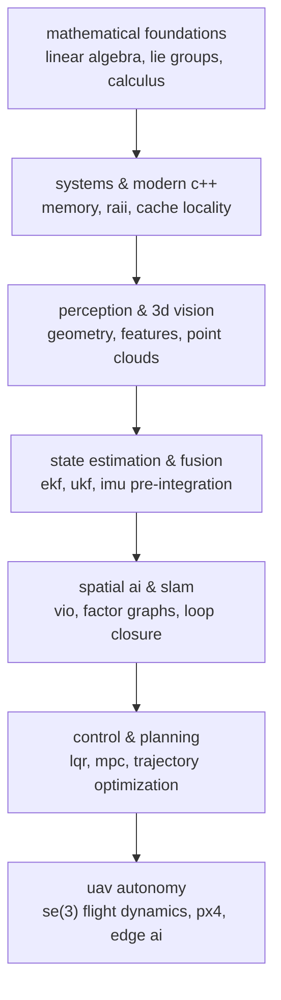

# ai-path

from first principles to autonomous flight: a ground-up engineering curriculum covering mathematics, modern c++, perception, spatial ai, control theory, and uav flight dynamics.

in an era where almost everything is generated by ai, i genuinely want to learn how things work from the ground up.

that is why every concept in this repository follows one rule: derive the mathematics on paper first, implement core algorithms from scratch without library abstractions, and write software architectures with modern c++ to understand the real-time constraints of robotics and autonomous systems.

---

## architecture pipeline

---

## curriculum roadmap

### 01. mathematical foundations
- **[math/linear-algebra/](./math/linear-algebra/)**: vector spaces, subspaces, linear independence, basis and dimension, inner product spaces, projections and orthogonalization (gram-schmidt), matrix decompositions (lu, qr, svd), eigenvalues and eigenvectors, hermitian and unitary matrices, matrix exponential.
- **multivariate calculus**: scalar and vector fields, partial derivatives, gradients, directional derivatives, jacobian and hessian matrices, taylor series expansions, chain rule in vector form, vector integration.
- **lie groups and manifolds**: rotations in 3d space, $so(3)$ and $se(3)$ manifolds, lie algebras $\mathfrak{so}(3)$ and $\mathfrak{se}(3)$, exponential and logarithmic maps, quaternions and attitude representations.
- **probability and statistics**: random variables, probability distributions, bayes' theorem, multivariate gaussian distributions, covariance matrices, propagation of uncertainty, maximum likelihood estimation (mle), maximum a posteriori (map).
- **differential equations**: ordinary differential equations (odes), linear time-invariant (lti) systems, state-space representations, stability analysis, numerical integration methods (euler, runge-kutta rk4).
- **numerical optimization**: unconstrained optimization, gradient descent, newton-raphson method, nonlinear least squares, gauss-newton algorithm, levenberg-marquardt optimization.

### 02. computer science and systems
- **[cs/](./cs/)**: fundamental data structures (arrays, linked lists, trees, graphs, heaps, hash tables), algorithmic complexity and big-o analysis, sorting and searching algorithms.
- **computer architecture**: memory hierarchy, l1/l2/l3 cache architecture, cache locality and cache misses, virtual memory, paging, instruction pipelining, branch prediction.
- **operating systems**: processes and threads, cpu scheduling, concurrency and race conditions, mutexes, semaphores, deadlock handling, inter-process communication (ipc), shared memory.
- **networking and middleware**: udp and tcp socket programming, publish-subscribe architecture, dds (data distribution service) standards, serialization protocols.
- **linux and development tooling**: linux command-line environment, bash scripting, process management, file permissions, build automation, git version control, ci/cd workflows.

### 03. systems programming and high-performance computing
- **[programming/cpp/](./programming/cpp/)**: modern c++ standards (c++17/c++20), memory layout, stack vs heap, pointers and references, pointer arithmetic, dynamic memory allocation, raii (resource acquisition is initialization), smart pointers (`unique_ptr`, `shared_ptr`, `weak_ptr`), move semantics and rvalue references, copy elision, template metaprogramming, lambda functions, stl containers and algorithms.
- **build systems**: modern cmake configuration, targets, dependencies, modular static and shared library compilation, compile-time optimization flags.
- **high-performance computing**: hardware-level simd vectorization, multi-threading (`std::thread`, thread pools), lock-free programming, profiling, memory leak detection with valgrind and sanitizers.
- **gpu programming**: cuda architecture, thread hierarchy (threads, blocks, grids), warp execution, shared memory vs global memory, writing parallel mathematical kernels.

### 04. machine learning and robot learning
- **[ml-dl/](./ml-dl/)**: statistical learning theory, linear and logistic regression, regularization (l1, l2), loss functions, optimization via stochastic gradient descent (sgd, adam).
- **deep learning architectures**: multi-layer perceptrons, convolutional neural networks (cnns), residual networks (resnet), recurrent architectures and transformers, attention mechanisms.
- **representation and metric learning**: contrastive learning, latent space embeddings, dimensionality reduction (pca, autoencoders).
- **robot learning and reinforcement learning**: markov decision processes (mdp), value iteration, policy iteration, q-learning, policy gradient methods, actor-critic architectures (ppo, sac), imitation learning, world models for physical interaction.

### 05. 2d computer vision
- **[vision/](./vision/)**: image formation, digital image representation, color spaces, spatial domain operations, convolution and spatial filtering, edge detection (sobel, canny), morphological operations.
- **feature detection and description**: corner detection (harris), scale-invariant features (sift, surf), binary robust features (orb, fast, brief), feature matching and descriptor distance metrics, geometric outlier rejection via ransac.
- **object detection and tracking**: classical sliding window and cascades, modern one-stage and two-stage object detectors, semantic and instance segmentation, optical flow methods (lucas-kanade, horn-schunck), visual target tracking algorithms.

### 06. 3d spatial vision and geometry
- **[3d-vision/](./3d-vision/)**: pinhole camera models, camera intrinsic matrix, lens distortion (radial and tangential), intrinsic and extrinsic camera calibration.
- **two-view and multi-view geometry**: epipolar geometry, fundamental matrix, essential matrix, eight-point algorithm, triangulation, 3d reconstruction from multiple views.
- **point cloud processing**: lidar and stereo point cloud structures, spatial indexing with kd-trees and octrees, point cloud filtering and downsampling (voxel grid), normal estimation, point cloud registration via iterative closest point (icp).
- **neural representations**: neural radiance fields (nerf), 3d gaussian splatting (3dgs) for real-time spatial scene representation.

### 07. state estimation and sensor fusion
- **[sensor-fusion/](./sensor-fusion/)**: sensor operational models and error characteristics (imu noise profiles, bias drift, white noise, random walk), gnss positioning models, lidar and camera spatial alignment.
- **state estimation algorithms**: linear kalman filter (kf), extended kalman filter (ekf), unscented kalman filter (ukf), error-state kalman filter (eskf) for attitude estimation, invariant ekf (iekf).
- **multi-sensor fusion**: tightly-coupled and loosely-coupled fusion architectures, imu-camera extrinsic calibration, imu-lidar temporal synchronization and time-offset estimation.

### 08. spatial ai and slam
- **[slam/](./slam/)**: visual odometry (vo), visual-inertial odometry (vio), lidar odometry and mapping (lio), scan matching algorithms (ndt, generalized icp).
- **imu pre-integration**: continuous-time imu kinematics, discrete-time integration on manifolds, covariance propagation, bias tracking.
- **graph-based optimization**: factor graph formulation, non-linear least squares on manifolds, information matrices, marginalization and sliding window filters, bundle adjustment (ba).
- **loop closure and mapping**: place recognition, visual bag-of-words (dbow), global pose graph optimization, occupancy grid mapping, 3d volumetric mapping (octomap).

### 09. robotics dynamics and simulation
- **[robotics/](./robotics/)**: rigid body kinematics, coordinate frame transformations, forward and inverse kinematics, denavit-hartenberg (dh) conventions, jacobians in robotics.
- **rigid body dynamics**: lagrangian formulation, newton-euler equations of motion, inertia tensors, equation of motion for multi-body systems, actuator modeling.
- **robotic middleware**: ros 2 computational graph, nodes, topics, services, actions, custom message interfaces, rclcpp programming, ros 2 lifecycle management.
- **physics simulation**: rigid body dynamics simulators, contact modeling, sensor simulation in gazebo and isaac sim, software-in-the-loop (sitl) environments.

### 10. planning and control theory
- **[planning-control/](./planning-control/)**: classical feedback control, transfer functions, frequency response, stability criteria, pid controllers, anti-windup mechanisms.
- **modern and optimal control**: state-space control, controllability and observability, pole placement, linear quadratic regulator (lqr), linear quadratic gaussian (lqg).
- **model predictive control (mpc)**: receding horizon principle, state and input constraints, discrete-time mpc formulation, real-time quadratic programming (qp) solvers.
- **motion planning algorithms**: graph search methods (dijkstra, a*, jump point search), sampling-based motion planning (rrt, rrt*, informed rrt*), kinodynamic trajectory generation, minimum jerk/snap polynomial trajectories, dynamic obstacle avoidance.

### 11. embedded systems and flight hardware
- **[embedded/](./embedded/)**: microcontroller architectures (arm cortex-m series), embedded c and bare-metal programming, memory-mapped i/o, register-level hardware configuration.
- **real-time systems**: real-time operating systems (freertos), task scheduling, priorities, queues, semaphores, real-time deadline guarantees.
- **hardware communication protocols**: low-level bus protocols (uart, usart, spi, i2c, can bus), dma (direct memory access) controllers, interrupt service routines (isr).
- **flight hardware integration**: power distribution, electronic speed controllers (esc), pwm/dshot protocols, sensors interfacing (spi-connected imu, i2c barometers).

### 12. uav dynamics and autonomous flight
- **[autonomy-flight/](./autonomy-flight/)**: 6-dof quadrotor flight dynamics, aerodynamic forces and moments, rotor dynamics, non-linear equations of motion, gyroscopic effects.
- **flight control architectures**: cascaded pid control loops (rate, attitude, velocity, position), geometric tracking control on $se(3)$, trajectory tracking algorithms.
- **autopilot systems**: px4 and ardupilot software architectures, uorb messaging, custom flight modes, mavlink protocol implementation, offboard control interface.
- **gps-denied navigation**: state estimation without external position references, visual-inertial autonomous hovering, lidar-based obstacle navigation, edge ai inference deployment (nvidia jetson, tensorrt acceleration).

---

all derivations, proofs, handwritten notes, and verification implementations are maintained in their respective directories.
