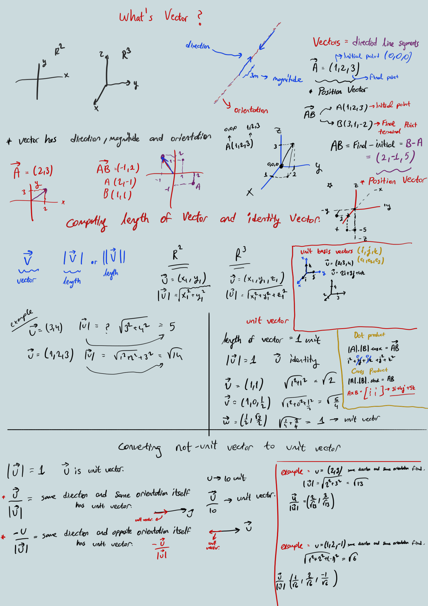
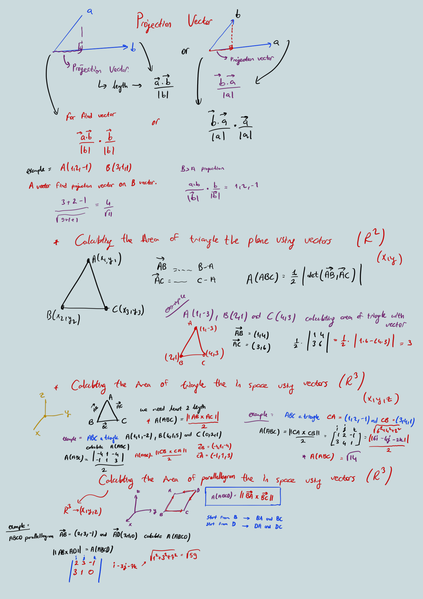

# Vector Geometry

handwritten notes and derivations for 3d euclidean vectors, norm, unit vector normalization, dot product, orthogonal projections, cross products and spatial area computations

[download full notes pdf](./vector-geometry.pdf) | [runnable script: src/vector_geometry.py](./src/vector_geometry.py)

---

## Vectors, Norms, and Unit Normalization

definition of geometric vectors in $\mathbb{R}^2$ and $\mathbb{R}^3$, position vectors, euclidean norm, and unit vector conversion

$$\Large \|\vec{v}\| = \sqrt{x^2 + y^2 + z^2} \quad \text{and} \quad \hat{v} = \frac{\vec{v}}{\|\vec{v}\|}$$



---

## Orthogonal Projections and 2D/3D Area Computation

scalar and vector projection of one vector onto another, triangle area in $\mathbb{R}^2$ using determinants, and spatial triangle and parallelogram areas using cross products

$$\Large \text{proj}_{\vec{b}}\vec{a} = \frac{\vec{a} \cdot \vec{b}}{\|\vec{b}\|^2} \vec{b} \quad \text{and} \quad \text{Area}_{\triangle} = \frac{1}{2} \|\vec{u} \times \vec{v}\|$$



---

## Computational Verification

computational verification of euclidean norm, unit vector normalization, vector projection, 2d determinant area, and 3d cross product areas using numpy.

$$\Large \hat{v} = \frac{\vec{v}}{\|\vec{v}\|}, \quad \text{proj}_{\vec{b}}\vec{a} = \frac{\vec{a} \cdot \vec{b}}{\|\vec{b}\|^2}\vec{b}, \quad \text{Area} = \frac{1}{2}\|\vec{u} \times \vec{v}\|$$

runnable script: [src/vector_geometry.py](./src/vector_geometry.py)

```python
# 1. norm and normalization
v = np.array([1, 2, -1])
norm_v = np.linalg.norm(v)
v_hat = v / norm_v

# 2. vector projection of a onto b
a = np.array([1, 2, -1])
b = np.array([3, 1, 1])
vector_proj = (np.dot(a, b) / np.dot(b, b)) * b

# 3. 2d area via determinant
AB = np.array([1, 4])
AC = np.array([3, 6])
area_2d = 0.5 * abs(np.linalg.det(np.column_stack([AB, AC])))

# 4. 3d triangle area via cross product
CA = np.array([1, 2, -1])
CB = np.array([3, 4, 1])
area_3d = 0.5 * np.linalg.norm(np.cross(CA, CB))

# 5. 3d parallelogram area
AB_par = np.array([2, 3, -1])
AD_par = np.array([3, 1, 0])
area_par = np.linalg.norm(np.cross(AB_par, AD_par))
```

```text
$ python src/vector_geometry.py
vector v: [ 1  2 -1]
norm of v: 2.4495
unit vector v_hat: [ 0.4082  0.8165 -0.4082]
norm of v_hat: 1.0
unit vector is normalized

a dot b: 4
scalar projection (length): 1.206
vector projection onto b: [1.0909 0.3636 0.3636]
projection matches manual calculation

2d triangle area: 3.0
2d area matches determinant calculation

CA x CB: [ 6 -4 -2]
3d triangle area: 3.7417
3d triangle area matches cross product magnitude

AB x AD: [ 1 -3 -7]
3d parallelogram area: 7.6811
3d parallelogram area matches cross product magnitude
```

---

## Real-World and Robotics Applications

where vector geometry and spatial products run inside real flight, robotics and computer vision code:

- **drone motor torque and angular acceleration**: quadrotor attitude dynamics rely directly on cross products. each motor generates aerodynamic drag and thrust at distance $\vec{r}$ from the center of gravity, producing torque $\vec{\tau} = \vec{r} \times \vec{F}$.
- **camera perspective projection in computer vision**: projecting 3d world landmarks onto a 2d camera sensor involves projecting point position vectors onto the camera optical axis and image plane basis vectors using dot products.
- **surface normal generation for lidar slam**: calculating the cross product of two non-parallel tangent vectors on a 3d point cluster gives the true surface normal vector $\vec{n} = \vec{u} \times \vec{v}$, used by point-to-plane icp registration in slam.
- **obstacle avoidance and line-of-sight guidance**: autonomous drone waypoint navigation normalizes relative position vectors to compute unit velocity heading commands:

  $$\Large \hat{r} = \frac{\vec{p}_{\text{target}} - \vec{p}_{\text{drone}}}{\|\vec{p}_{\text{target}} - \vec{p}_{\text{drone}}\|}$$
