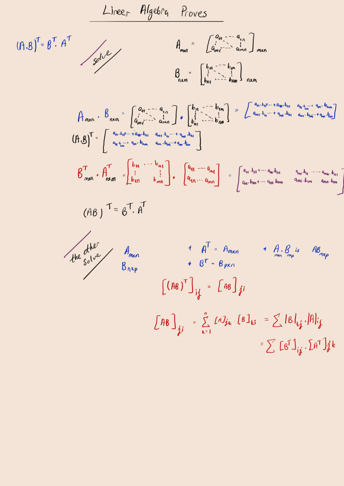
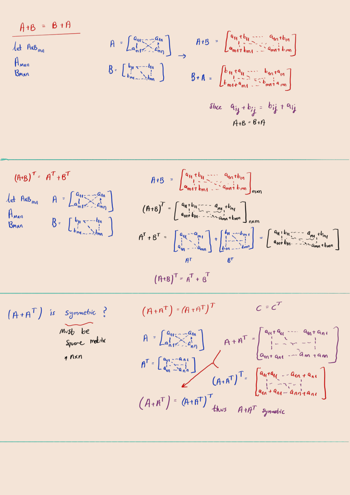
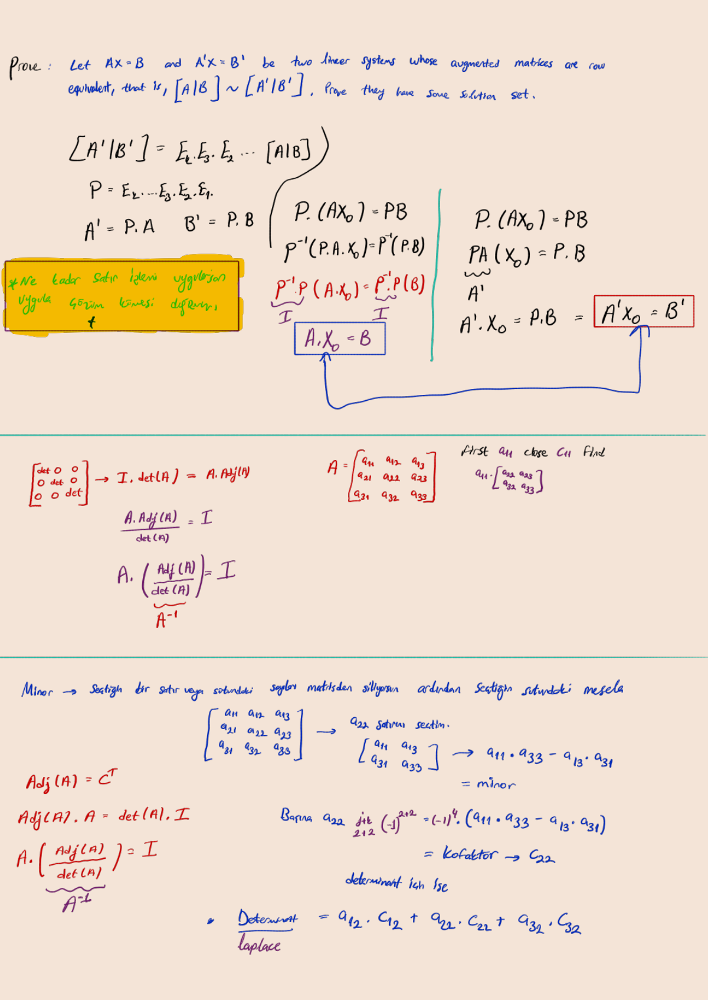
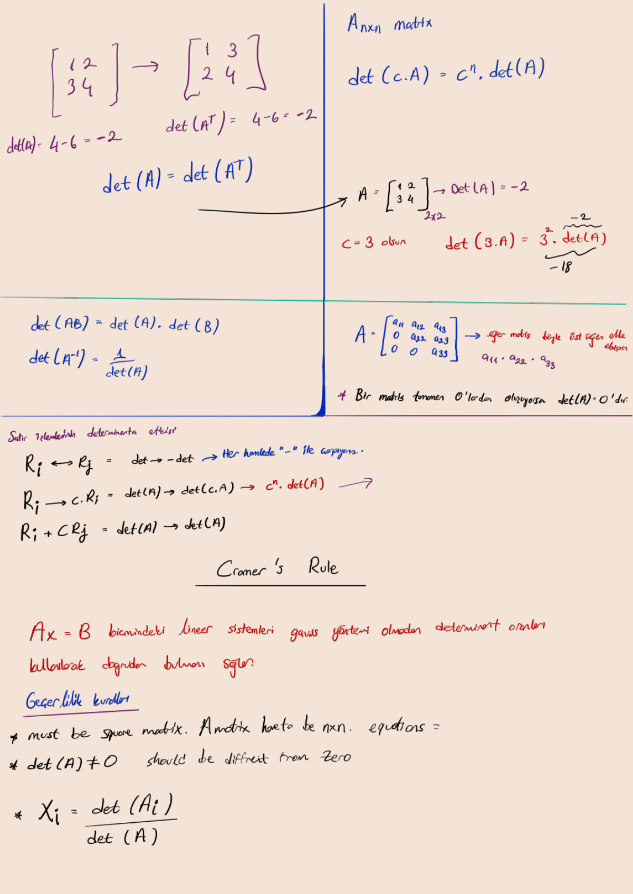

# Linear Algebra Proofs

handwritten derivations and proofs for fundamental matrix algebra operations with direct computational verifications

[download full notes pdf](./linear-algebra-proofs.pdf) | [runnable script: src/matrix_proofs.py](./src/matrix_proofs.py)

---

## Transpose and Matrix Symmetry

handwritten derivations for matrix transpose rules, addition commutativity and symmetric matrix decomposition

$$\Large (AB)^T = B^T A^T \quad \text{and} \quad (A + B)^T = A^T + B^T$$

$$\Large A = \frac{1}{2}(A + A^T) + \frac{1}{2}(A - A^T)$$




### Computational Verification

```python
# transpose of product: (AB)^T == B^T @ A^T
left_t = (A @ B).T
right_t = B.T @ A.T
assert np.allclose(left_t, right_t)

# symmetric and skew-symmetric decomposition: A == A_sym + A_skew
sym = 0.5 * (A + A.T)
skew = 0.5 * (A - A.T)
assert np.allclose(A, sym + skew)
```

```text
transpose property holds: (AB)^T == B^T @ A^T
decomposition holds: A == A_sym + A_skew
```

---

## Skew Symmetry and Inverse Uniqueness

proofs for skew symmetric decomposition, inverse uniqueness, left and right inverse equivalence and product inverses

$$\Large (A - A^T)^T = -(A - A^T)$$

$$\Large A A' = A A'' = I \implies A' = A'' \quad \text{and} \quad BA = I, \, AC = I \implies B = C$$

$$\Large (AB)^{-1} = B^{-1} A^{-1}$$


### Computational Verification

```python
# inverse of product: (AB)^-1 == B^-1 @ A^-1
inv_AB = np.linalg.inv(A @ B)
inv_B_inv_A = np.linalg.inv(B) @ np.linalg.inv(A)
assert np.allclose(inv_AB, inv_B_inv_A)
```

```text
inverse property holds: (AB)^-1 == B^-1 @ A^-1
```

---

## Row Operations and Rectangular Matrices

elementary row operations, row equivalence invariance of linear systems and inverse conditions on rectangular matrices

$$\Large [A \mid B] \sim [A' \mid B'] \implies A' = P A, \quad B' = P B$$




---

## Determinants and Cramer Rule

determinant properties, derivation of cramer rule and step by step solution of 3x3 linear systems

$$\Large \det(AB) = \det(A)\det(B), \quad \det(cA) = c^n \det(A), \quad \det(A^{-1}) = \frac{1}{\det(A)}$$

$$\Large x_i = \frac{\det(A_i)}{\det(A)}$$




### Computational Verification

```python
# determinant multiplicative property: det(AB) == det(A) * det(B)
det_AB = np.linalg.det(A @ B)
det_A_det_B = np.linalg.det(A) * np.linalg.det(B)
assert np.isclose(det_AB, det_A_det_B)

# cramer's rule vs np.linalg.solve
det_A = np.linalg.det(A)
A0 = A.copy(); A0[:, 0] = b
A1 = A.copy(); A1[:, 1] = b
x_cramer = np.array([np.linalg.det(A0) / det_A, np.linalg.det(A1) / det_A])
x_solve = np.linalg.solve(A, b)
assert np.allclose(x_cramer, x_solve)
```

```text
det(AB) = 50.0000, det(A)*det(B) = 50.0000
det(A^-1) = 0.2000, 1/det(A) = 0.2000
cramer solution: [1.4 2.2]
numpy solve:     [1.4 2.2]
cramer matches np.linalg.solve
```

---

## Adjugate Matrix Properties

properties of the adjugate matrix and determinant relations

$$\Large A \cdot \text{adj}(A) = \det(A) I \implies A^{-1} = \frac{\text{adj}(A)}{\det(A)}$$

$$\Large \det(\text{adj}(A)) = (\det(A))^{n-1}$$


---

## Real-World and Robotics Applications

where these matrix identities run inside real systems code:

- **3d drone orientation and rotation**: a drone or robot orientation is stored as a rotation matrix $R$. because rotation matrices are orthogonal, inverting orientation is just transposing ($R^{-1} = R^T$), which costs almost zero cpu cycles on flight microcontrollers.
- **coordinate frames and camera transforms**: transforming a detected target from camera coordinates to world coordinates is a chain of transformations:

  $$\Large T_{c \to w} = T_{b \to w} T_{c \to b}$$

  going backwards requires inverting the chain, where $(AB)^{-1} = B^{-1} A^{-1}$ flips the multiplication order.
- **robot arm singularity avoidance**: in manipulator kinematics, joint velocities map to end-effector velocity via the jacobian matrix $J$. when $\det(J) \to 0$, the inverse blows up, motor torque demands become infinite, and the arm locks up. real-time controllers check the determinant to avoid singularity boundaries.
- **fast sensor calibration on microcontrollers**: solving small $2 \times 2$ or $3 \times 3$ calibration equations on stm32 or px4 flight computers is often done branchless using cramer's rule determinants without importing heavy linear algebra libraries.
