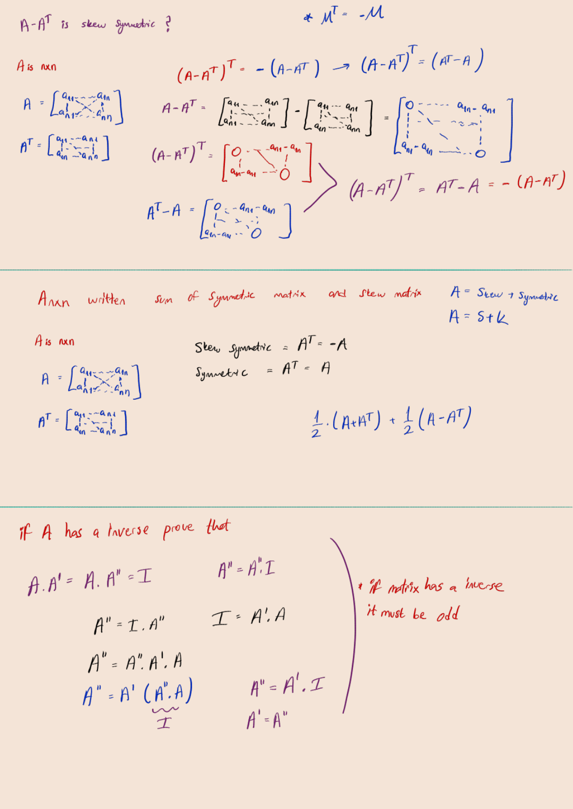
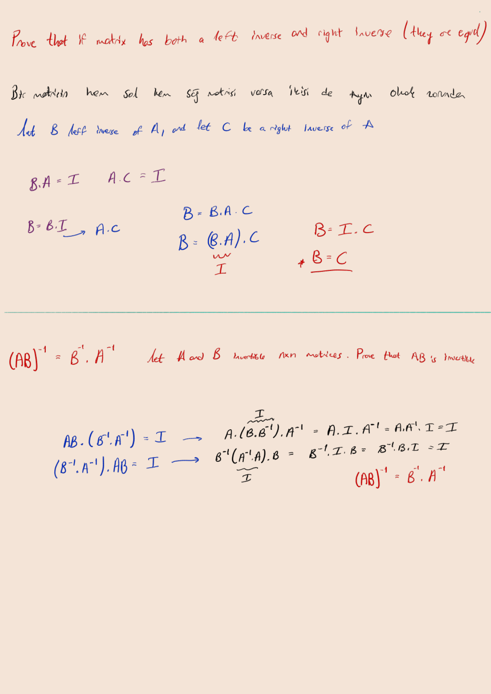
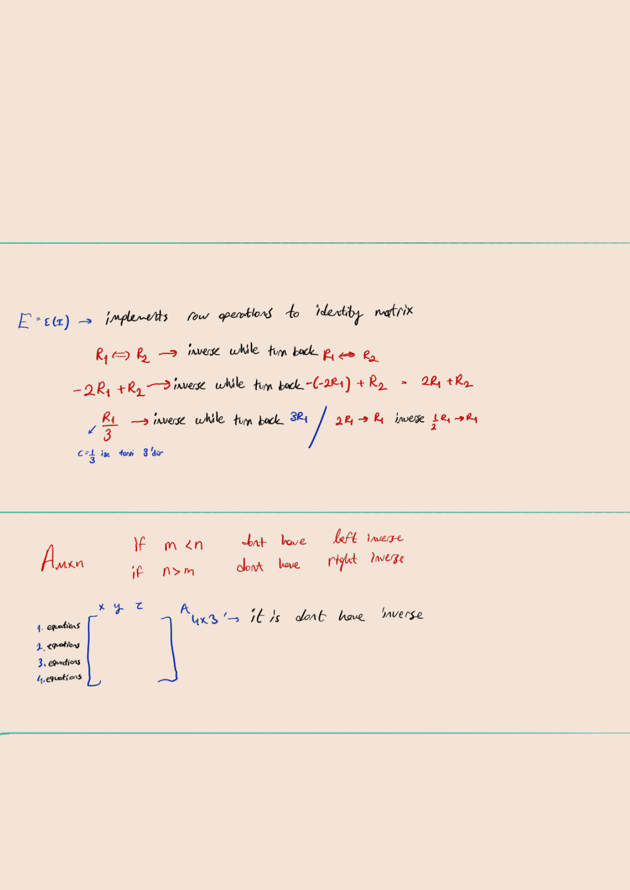
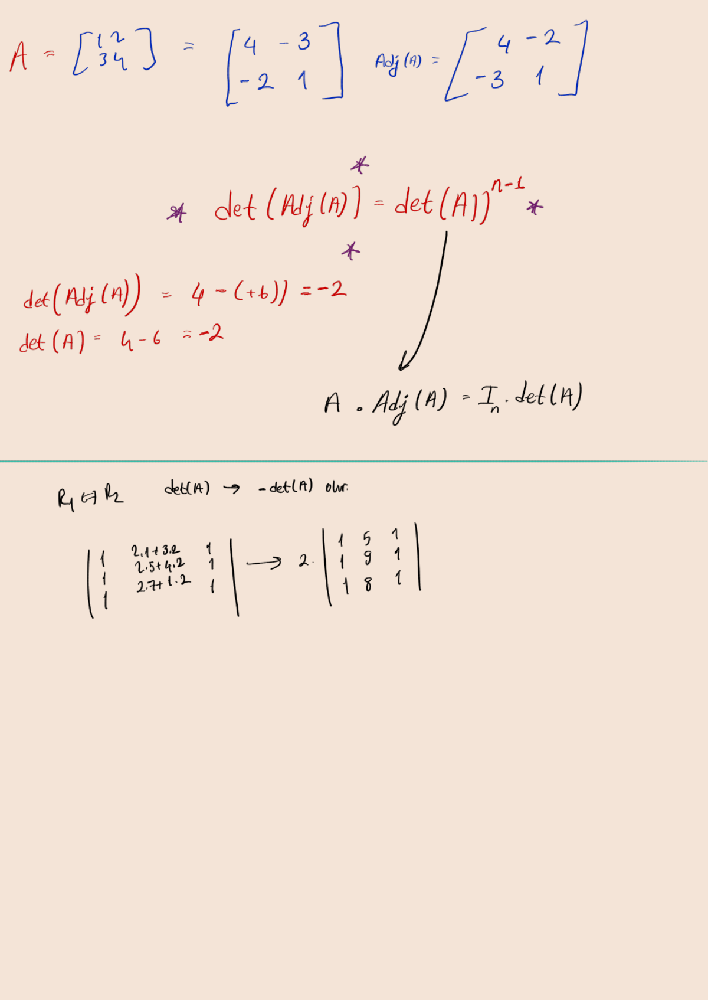

# Linear Algebra Proofs

handwritten derivations and proofs for fundamental matrix algebra operations

[download full notes pdf](./linear-algebra-proofs.pdf)

---

## Transpose and Matrix Symmetry

handwritten derivations for matrix transpose rules, addition commutativity and symmetric matrix decomposition

$$(AB)^T = B^T A^T \quad \text{and} \quad (A + B)^T = A^T + B^T$$

$$A = \frac{1}{2}(A + A^T) + \frac{1}{2}(A - A^T)$$

---

## Skew Symmetry and Inverse Uniqueness

proofs for skew symmetric decomposition, inverse uniqueness, left and right inverse equivalence and product inverses

$$(A - A^T)^T = -(A - A^T)$$

$$A A' = A A'' = I \implies A' = A'' \quad \text{and} \quad BA = I, \, AC = I \implies B = C$$

$$(AB)^{-1} = B^{-1} A^{-1}$$

---

## Row Operations and Rectangular Matrices

elementary row operations, row equivalence invariance of linear systems and inverse conditions on rectangular matrices

$$[A \mid B] \sim [A' \mid B'] \implies A' = P A, \quad B' = P B$$

---

## Determinants and Cramer Rule

determinant properties, derivation of cramer rule and step by step solution of 3x3 linear systems

$$\det(AB) = \det(A)\det(B), \quad \det(cA) = c^n \det(A), \quad \det(A^{-1}) = \frac{1}{\det(A)}$$

$$x_i = \frac{\det(A_i)}{\det(A)}$$

---

## Adjugate Matrix Properties

properties of the adjugate matrix and determinant relations

$$A \cdot \text{adj}(A) = \det(A) I \implies A^{-1} = \frac{\text{adj}(A)}{\det(A)}$$

$$\det(\text{adj}(A)) = (\det(A))^{n-1}$$

