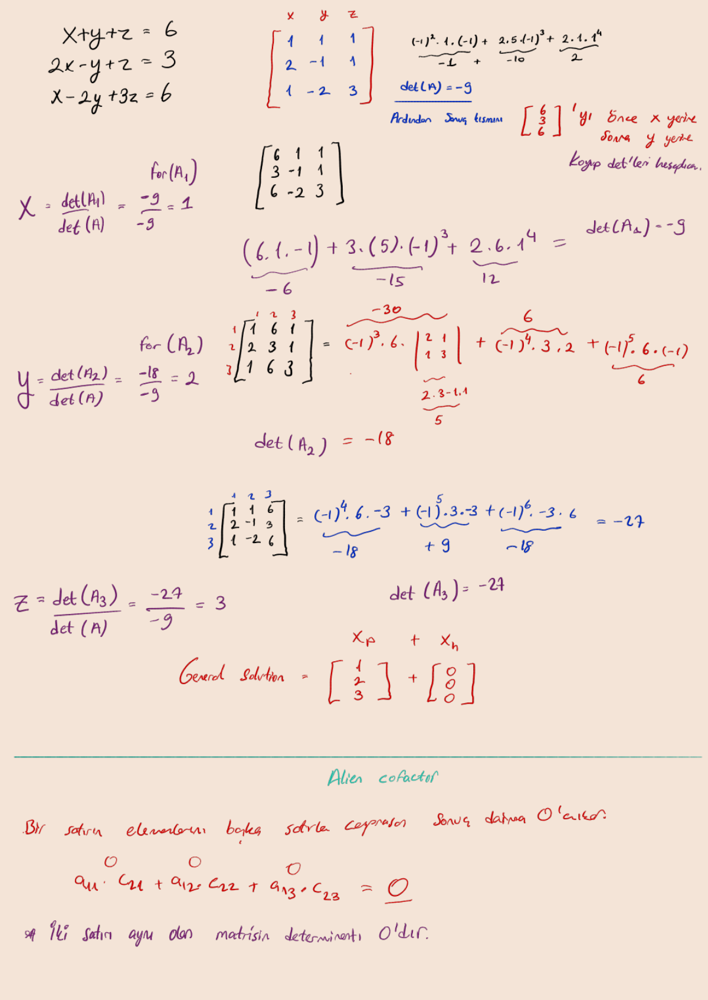

# Linear Algebra Proofs

handwritten derivations and proofs for fundamental matrix algebra operations

[download full notes pdf](./linear-algebra-proofs.pdf)

---

## Transpose and Matrix Symmetry

handwritten derivations for matrix transpose rules, addition commutativity and symmetric matrix decomposition

$$\Large (AB)^T = B^T A^T \quad \text{and} \quad (A + B)^T = A^T + B^T$$

$$\Large A = \frac{1}{2}(A + A^T) + \frac{1}{2}(A - A^T)$$


---

## Skew Symmetry and Inverse Uniqueness

proofs for skew symmetric decomposition, inverse uniqueness, left and right inverse equivalence and product inverses

$$\Large (A - A^T)^T = -(A - A^T)$$

$$\Large A A' = A A'' = I \implies A' = A'' \quad \text{and} \quad BA = I, \, AC = I \implies B = C$$

$$\Large (AB)^{-1} = B^{-1} A^{-1}$$


---

## Row Operations and Rectangular Matrices

elementary row operations, row equivalence invariance of linear systems and inverse conditions on rectangular matrices

$$\Large [A \mid B] \sim [A' \mid B'] \implies A' = P A, \quad B' = P B$$


---

## Determinants and Cramer Rule

determinant properties, derivation of cramer rule and step by step solution of 3x3 linear systems

$$\Large \det(AB) = \det(A)\det(B), \quad \det(cA) = c^n \det(A), \quad \det(A^{-1}) = \frac{1}{\det(A)}$$

$$\Large x_i = \frac{\det(A_i)}{\det(A)}$$




---

## Adjugate Matrix Properties

properties of the adjugate matrix and determinant relations

$$\Large A \cdot \text{adj}(A) = \det(A) I \implies A^{-1} = \frac{\text{adj}(A)}{\det(A)}$$

$$\Large \det(\text{adj}(A)) = (\det(A))^{n-1}$$


---

## Computational Verification

computational verification of matrix transpose identities, symmetric decomposition, product inverses, determinant properties, and cramer's rule using numpy.

$$\Large (AB)^T = B^T A^T, \quad (AB)^{-1} = B^{-1} A^{-1}, \quad \det(AB) = \det(A)\det(B)$$

runnable script: [src/matrix_proofs.py](./src/matrix_proofs.py)

```text
$ python src/matrix_proofs.py
=== 1. transpose of product: (AB)^T == B^T @ A^T ===
verification: SUCCESS ((AB)^T == B^T @ A^T)

=== 2. symmetric and skew-symmetric decomposition ===
verification: SUCCESS (A == A_sym + A_skew)

=== 3. inverse of product: (AB)^-1 == B^-1 @ A^-1 ===
verification: SUCCESS ((AB)^-1 == B^-1 @ A^-1)

=== 4. determinant properties ===
det(AB) = 50.0000, det(A)*det(B) = 50.0000
verification: SUCCESS (det(AB) == det(A) * det(B))
det(A^-1) = 0.2000, 1/det(A) = 0.2000
verification: SUCCESS (det(A^-1) == 1 / det(A))

=== 5. cramer's rule vs numpy solve ===
cramer's rule solution: [1.4 2.2]
numpy linalg solve:     [1.4 2.2]
verification: SUCCESS (cramer matches np.linalg.solve)
```
