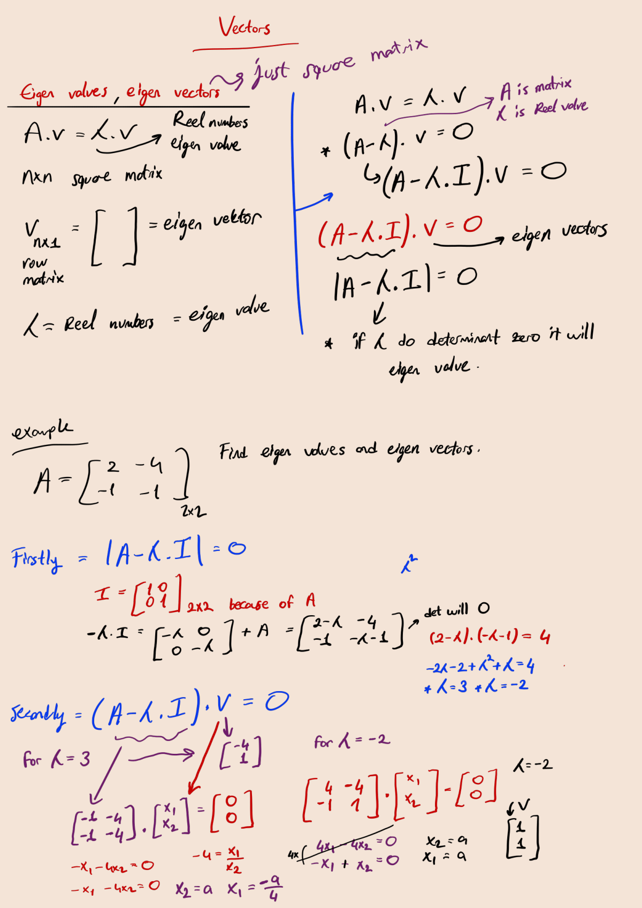
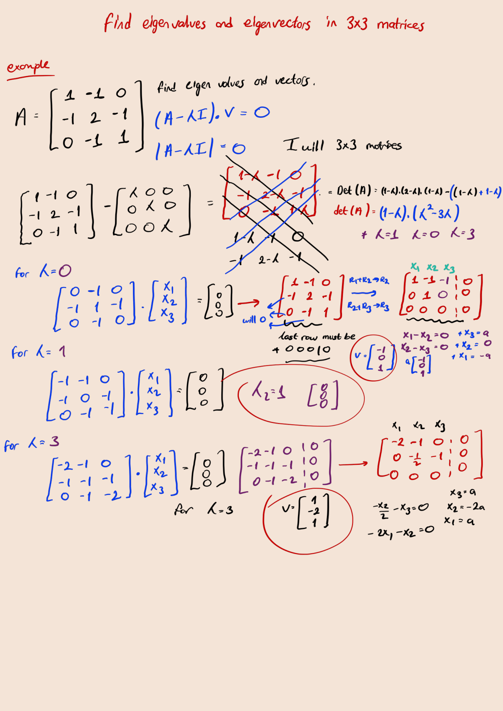
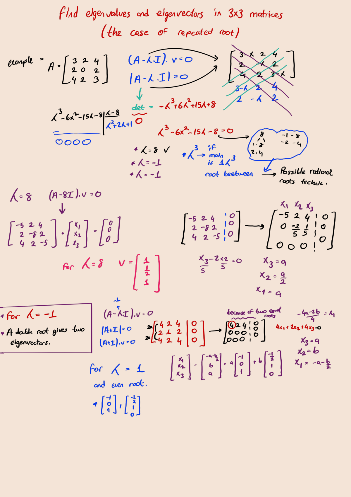
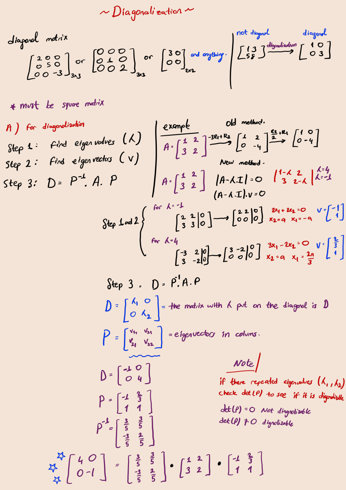

# Vectors and Eigenvalues

handwritten notes and derivations for eigenvalues eigenvectors spectral properties and matrix diagonalization

[download full notes pdf](./vectors.pdf)

---

## Eigenvalues and Eigenvectors Definition

fundamental definition of eigenvalues and eigenvectors from the characteristic equation with step by step two by two matrix solution

---

## Core Properties and Applications

relationship between eigenvalues determinant and trace along with applications in diagonalization and differential systems

---

## Two by Two Systems and Complex Roots

analysis of distinct real roots repeated roots and complex conjugate eigenvalue pairs in two by two systems

---

## Three by Three Systems and Distinct Roots

characteristic polynomial derivation and eigenvector computation for three by three matrices using row reduction

---

## Repeated Roots and Multiplicity

handling repeated eigenvalues and determining eigenvectors in degenerate cases

---

## Matrix Diagonalization

constructing modal matrix and diagonal matrix with step by step verification of similarity transformations

---

## Multiplicity and Diagonalizability Conditions

algebraic versus geometric multiplicity and necessary conditions for matrix diagonalizability

