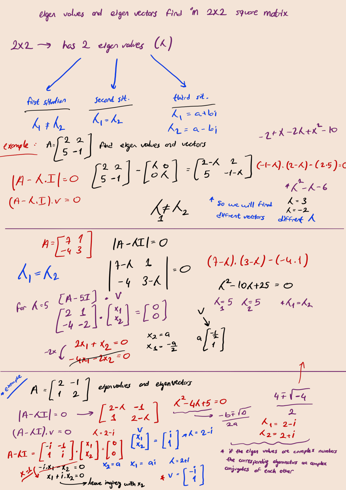
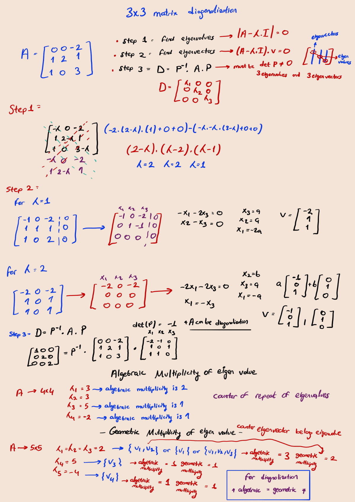
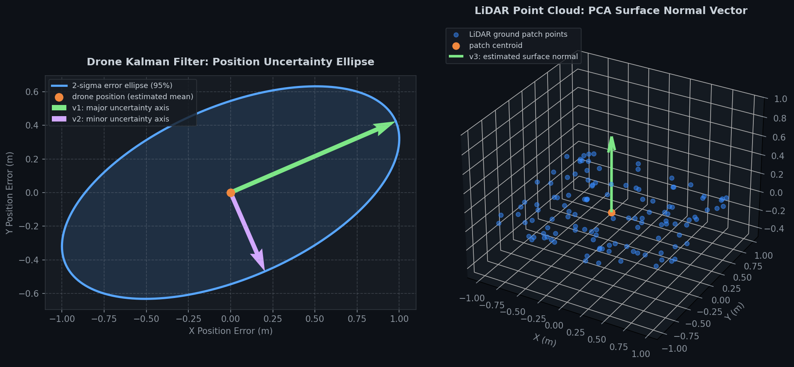

# Vectors and Eigenvalues

handwritten notes and derivations for eigenvalues eigenvectors spectral properties and matrix diagonalization

[download full notes pdf](./vectors.pdf)

---

## Eigenvalues and Eigenvectors Definition

fundamental definition of eigenvalues and eigenvectors from the characteristic equation with step by step two by two matrix solution

$$\Large A v = \lambda v \iff (A - \lambda I) v = 0 \iff \det(A - \lambda I) = 0$$


---

## Core Properties and Applications

relationship between eigenvalues determinant and trace along with applications in diagonalization and differential systems

$$\Large \det(A) = \prod_{i=1}^n \lambda_i \quad \text{and} \quad \text{tr}(A) = \sum_{i=1}^n \lambda_i$$


---

## Two by Two Systems and Complex Roots

analysis of distinct real roots repeated roots and complex conjugate eigenvalue pairs in two by two systems

$$\Large \lambda_{1, 2} = a \pm bi \implies v_{1, 2} = u \pm iw$$



---

## Three by Three Systems and Distinct Roots

characteristic polynomial derivation and eigenvector computation for three by three matrices using row reduction

$$\Large p(\lambda) = \det(A - \lambda I) = 0 \implies (A - \lambda_k I) v_k = 0$$


---

## Repeated Roots and Multiplicity

handling repeated eigenvalues and determining eigenvectors in degenerate cases

$$\Large \text{algebraic multiplicity} \ge \text{geometric multiplicity}$$


---

## Matrix Diagonalization

constructing modal matrix and diagonal matrix with step by step verification of similarity transformations

$$\Large D = P^{-1} A P \iff A = P D P^{-1}$$


---

## Multiplicity and Diagonalizability Conditions

algebraic versus geometric multiplicity and necessary conditions for matrix diagonalizability

$$\Large A \text{ is diagonalizable} \iff \text{alg mult}(\lambda) = \text{geom mult}(\lambda) \quad \forall \lambda$$



---

## Software and Robotics Applications

where eigenvalues and eigenvectors run inside autonomous systems code



### 1. drone kalman filter: error ellipse

in robot localization and sensor fusion, the kalman filter estimates state $(x, y)$ along with a covariance matrix $\Sigma$. the eigenvalues of $\Sigma$ give the squared lengths of the semi-axes, and the eigenvectors define the tilt of the uncertainty ellipse in 2d space.

$$\Large \Sigma v = \lambda v \implies \text{semi-axes} = 2\sqrt{\lambda_1}, \, 2\sqrt{\lambda_2}$$

### 2. lidar point cloud: surface normal estimation

in 3d perception, an autonomous ground robot or drone fits a local plane to a cluster of lidar points. by taking the covariance of neighboring points, the eigenvector corresponding to the smallest eigenvalue $\lambda_3 \approx 0$ gives the surface normal vector $\vec{n}$.

$$\Large \text{cov}(P) v_3 = \lambda_{\min} v_3 \implies \vec{n} = v_3$$

### Execution and Output

runnable script: [src/eigen_robotics.py](./src/eigen_robotics.py)

```text
$ python src/eigen_robotics.py
--- drone kalman filter error ellipse ---
semi-major axis (uncertainty): 1.067 m
semi-minor axis (uncertainty): 0.511 m
ellipse orientation angle:    23.42 deg

--- lidar point cloud surface normal ---
estimated normal vector: [0.001, 0.003, 1.000]
expected normal vector:  [0.000, 0.000, 1.000] (flat ground)

visual plot generated at: robotics_eigen_visual.png
```
