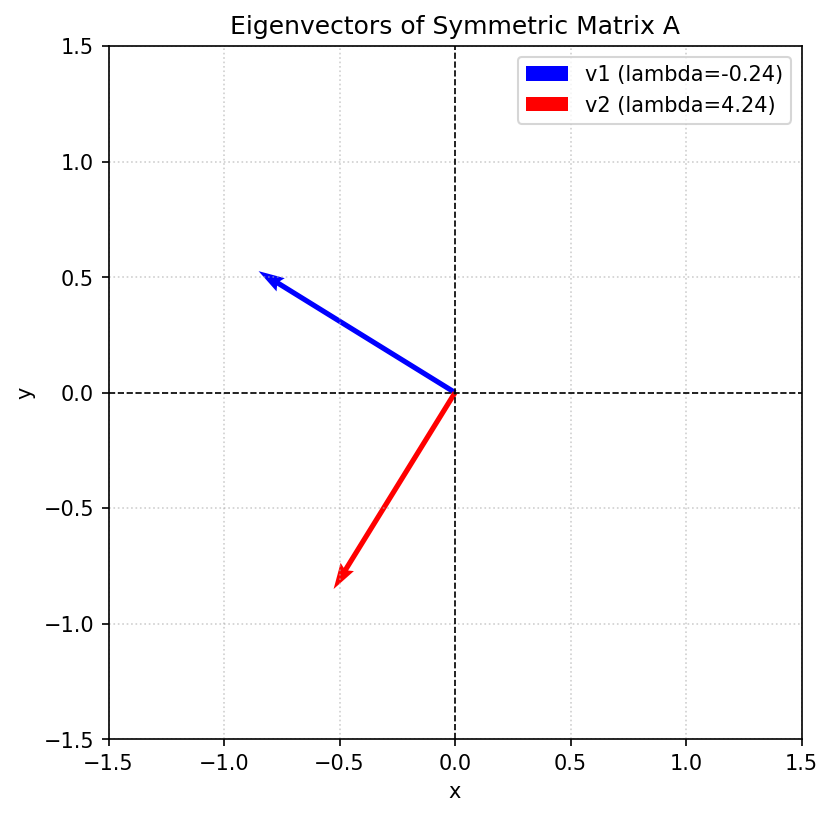
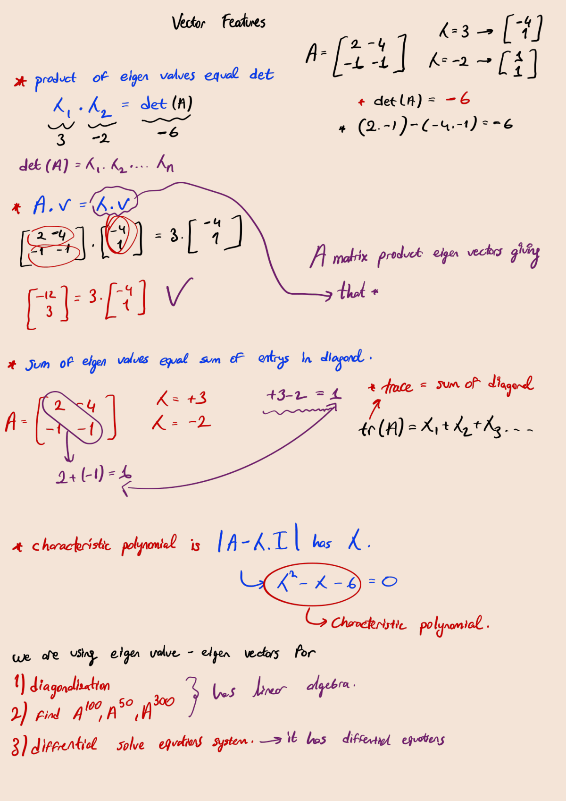

# Vectors and Eigenvalues

handwritten notes and derivations for eigenvalues eigenvectors spectral properties and matrix diagonalization

[download full notes pdf](./vectors.pdf)

---

## Eigenvalues and Eigenvectors Definition

fundamental definition of eigenvalues and eigenvectors from the characteristic equation with step by step two by two matrix solution

$$\Large A v = \lambda v \iff (A - \lambda I) v = 0 \iff \det(A - \lambda I) = 0$$


### Computational Verification and Visualization

computational verification of $A v = \lambda v$ and 2d orthogonal eigenvector visualization for symmetric matrix $A$.

$$\Large A v = \lambda v \quad \text{and} \quad v_1 \cdot v_2 = 0$$



runnable script: [src/eigen_verification.py](./src/eigen_verification.py)

```text
$ python src/eigen_verification.py
eigenvalues1: -0.2360679774997898
eigenvectors1:
 [-0.85065081  0.52573111]
eigenvalues2: 4.23606797749979
eigenvectors2:
 [-0.52573111 -0.85065081]

eigenpair : 1
eigenvalue: -0.2360679774997898
eigenvector:
 [-0.85065081  0.52573111]
(A @ v == lambda * v)

eigenpair : 2
eigenvalue: 4.23606797749979
eigenvector:
 [-0.52573111 -0.85065081]
(A @ v == lambda * v)

plot saved to assets/eigenvectors_plot.png
```

---

## Core Properties and Applications

relationship between eigenvalues determinant and trace along with applications in diagonalization and differential systems

$$\Large \det(A) = \prod_{i=1}^n \lambda_i \quad \text{and} \quad \text{tr}(A) = \sum_{i=1}^n \lambda_i$$



---

## Two by Two Systems and Complex Roots

analysis of distinct real roots repeated roots and complex conjugate eigenvalue pairs in two by two systems

$$\Large \lambda_{1, 2} = a \pm bi \implies v_{1, 2} = u \pm iw$$


---

## Three by Three Systems and Distinct Roots

characteristic polynomial derivation and eigenvector computation for three by three matrices using row reduction

$$\Large p(\lambda) = \det(A - \lambda I) = 0 \implies (A - \lambda_k I) v_k = 0$$


---

## Repeated Roots and Multiplicity

handling repeated eigenvalues and determining eigenvectors in degenerate cases

$$\Large \text{algebraic multiplicity} \ge \text{geometric multiplicity}$$


---

## Matrix Diagonalization

constructing modal matrix and diagonal matrix with step by step verification of similarity transformations

$$\Large D = P^{-1} A P \iff A = P D P^{-1}$$


### Computational Verification

verifying similarity transformation $D = P^{-1} A P$ using modal matrix $P$ constructed from eigenvectors.

runnable script: [src/diagonalization.py](./src/diagonalization.py)

```text
$ python src/diagonalization.py
matrix A:
 [[1 2]
 [2 3]]

Modal matrix P (eigenvectors):
 [[-0.85065081 -0.52573111]
 [ 0.52573111 -0.85065081]]

Expected D (diagonal):
 [[-0.23606798  0.        ]
 [ 0.          4.23606798]]

Computed D (P_inv @ A @ P):
 [[-2.36067977e-01  9.71445147e-17]
 [ 4.44089210e-16  4.23606798e+00]]

Diagonalization theorem is okey! (D == P_inv @ A @ P)
```

---

## Multiplicity and Diagonalizability Conditions

algebraic versus geometric multiplicity and necessary conditions for matrix diagonalizability

$$\Large A \text{ is diagonalizable} \iff \text{alg mult}(\lambda) = \text{geom mult}(\lambda) \quad \forall \lambda$$


