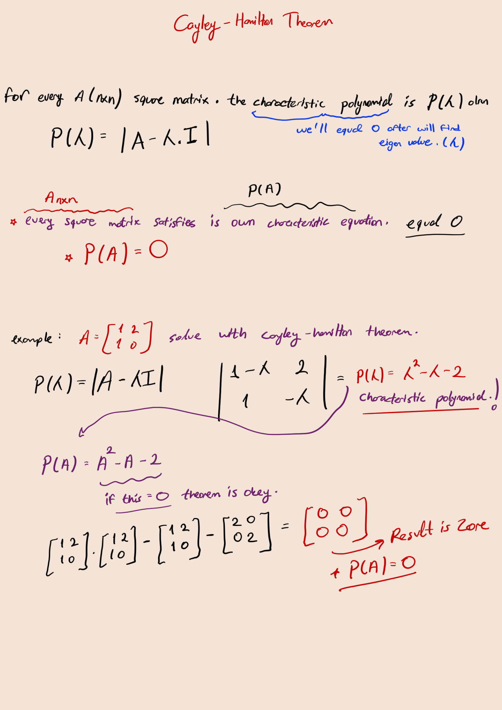
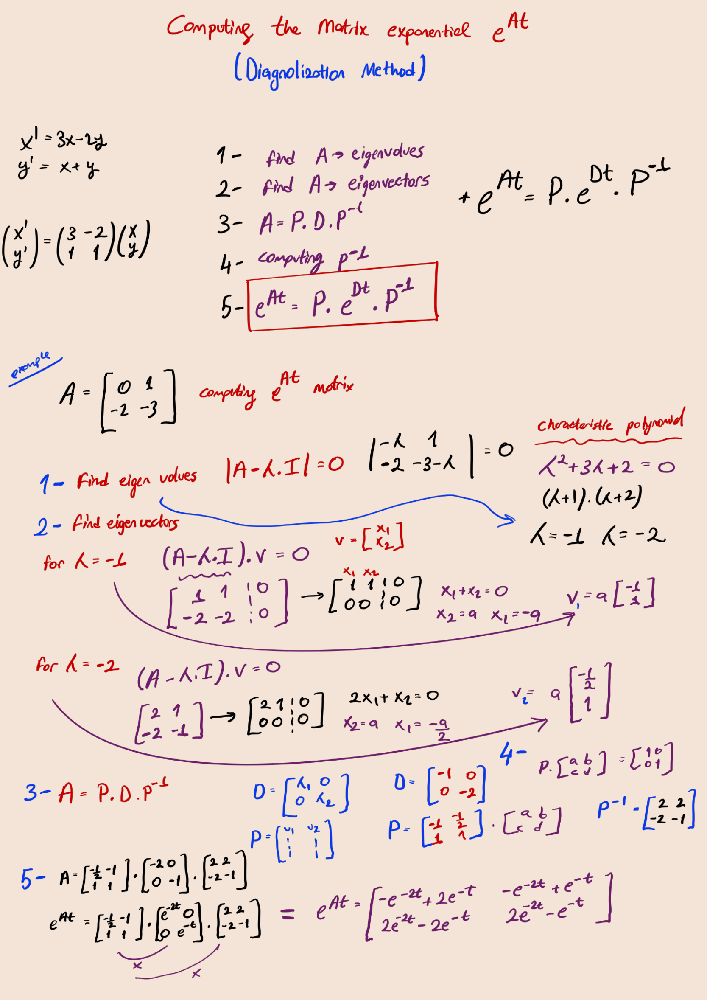
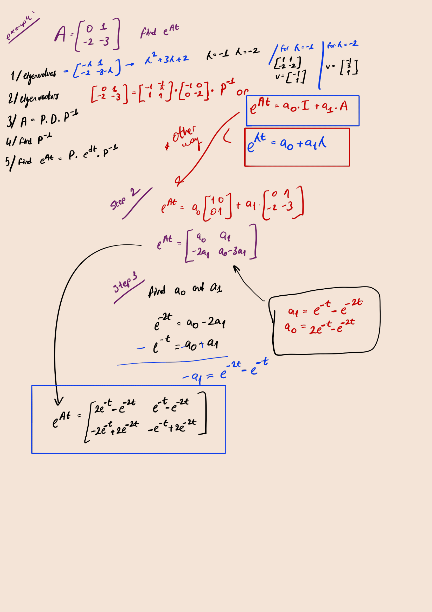

# Matrix Exponential and Cayley-Hamilton Theorem

handwritten notes and derivations for the cayley-hamilton theorem and matrix exponential ($e^{At}$) computation using diagonalization and characteristic polynomial methods

[download full notes pdf](./matrix-exponential.pdf) | [runnable script: src/matrix_exponential.py](./src/matrix_exponential.py)

---

## Cayley-Hamilton Theorem

definition of the cayley-hamilton theorem stating that every square matrix satisfies its own characteristic equation

$$\Large P(\lambda) = \det(A - \lambda I) = 0 \implies P(A) = 0$$



---

## Matrix Exponential via Diagonalization

derivation and step by step procedure for computing the matrix exponential $e^{At}$ using similarity transformation and the modal matrix $P$

$$\Large e^{At} = P e^{Dt} P^{-1} \quad \text{where} \quad e^{Dt} = \text{diag}(e^{\lambda_1 t}, \dots, e^{\lambda_n t})$$



---

## Matrix Exponential via Cayley-Hamilton Method

alternative evaluation of $e^{At}$ using the cayley-hamilton theorem to express the infinite matrix series as a finite matrix polynomial

$$\Large e^{At} = \alpha_0 I + \alpha_1 A \quad \text{with} \quad e^{\lambda_i t} = \alpha_0 + \alpha_1 \lambda_i$$



---

## Computational Verification

computational verification comparing both the diagonalization method and the cayley-hamilton method for $e^{At}$ using numpy.

$$\Large P e^{Dt} P^{-1} = \alpha_0 I + \alpha_1 A = e^{At}$$

runnable script: [src/matrix_exponential.py](./src/matrix_exponential.py)

```python
# test matrix A and time parameter t
A = np.array([[4, -2], [1, 1]])
t = 1.0

# 1. diagonalization method
eigenvalues, eigenvectors = np.linalg.eig(A)
P = eigenvectors
e_Dt = np.diag(np.exp(eigenvalues * t))
e_At_diag = P @ e_Dt @ np.linalg.inv(P)

# 2. cayley-hamilton method (lambda_1 = 3, lambda_2 = 2)
a1 = np.exp(3 * t) - np.exp(2 * t)
a0 = 3 * np.exp(2 * t) - 2 * np.exp(3 * t)
e_At_cayley = (a0 * np.eye(2)) + (a1 * A)

assert np.allclose(e_At_diag, e_At_cayley)
```

```text
$ python src/matrix_exponential.py
 using eigen decomposition:
 [[ 32.78201775 -25.39296165]
 [ 12.69648082  -5.30742473]]
 using Cayley-Hamilton theorem:
 [[ 32.78201775 -25.39296165]
 [ 12.69648082  -5.30742473]]

both of method give the same result
```

---

## Real-World and Robotics Applications

where matrix exponential ($e^{At}$) runs inside real flight and autonomous systems code:

- **linear time-invariant (lti) flight dynamics**: a continuous-time drone or aircraft state-space model is defined by $\dot{x}(t) = A x(t) + B u(t)$. the exact closed-form solution for state propagation from time $t_0$ to $t$ is $x(t) = e^{A(t - t_0)} x(t_0)$, known as the state transition matrix $\Phi(t)$.
- **digital flight controller discretization**: flight control software runs on discrete clock ticks (e.g. 400 hz in px4 / ardupilot). converting continuous differential physics matrices $(A, B)$ into discrete update matrices $(A_d, B_d)$ is done by computing the matrix exponential $A_d = e^{A \Delta t}$.
- **finite expansion via cayley-hamilton on microcontrollers**: calculating the infinite taylor series of $e^{At}$ directly is impossible in real-time embedded systems. cayley-hamilton reduces the infinite series to an exact polynomial of order $n-1$, allowing fast closed-form updates on stm32 flight microcontrollers.
