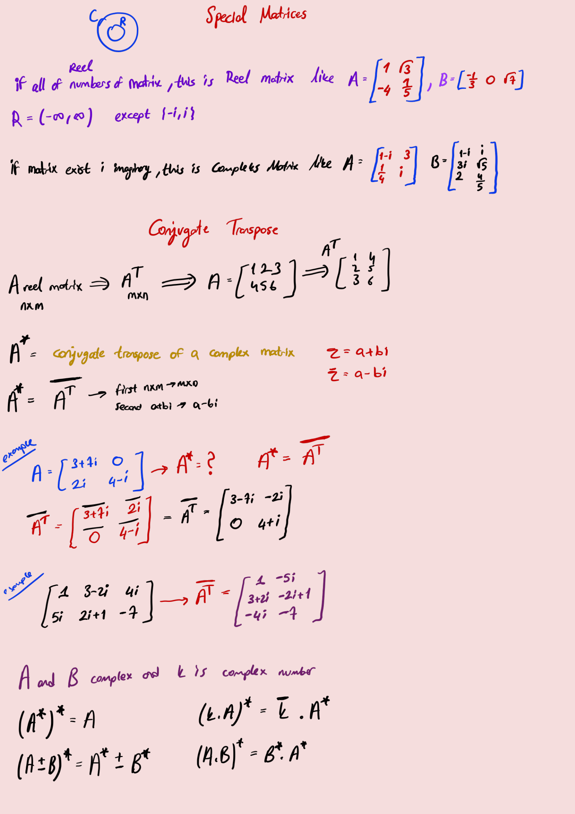
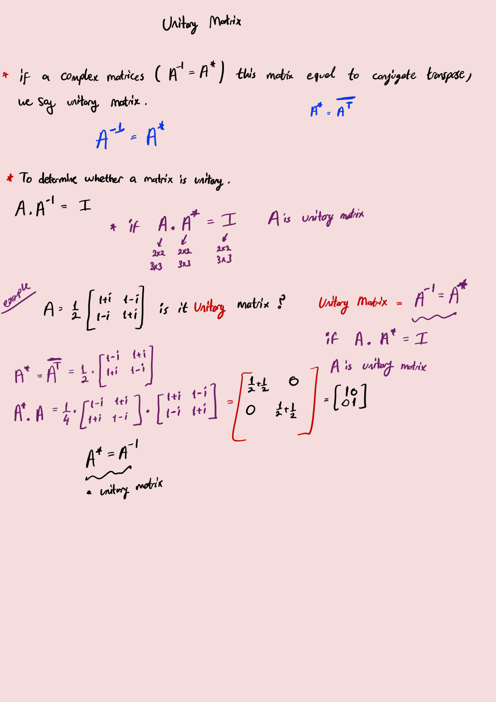
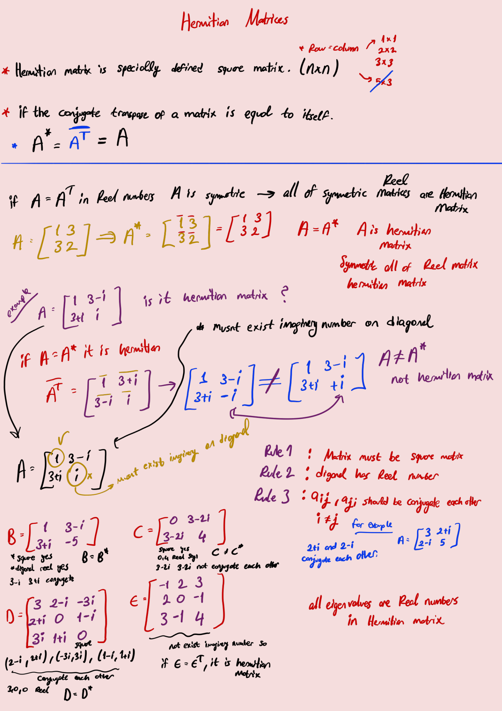
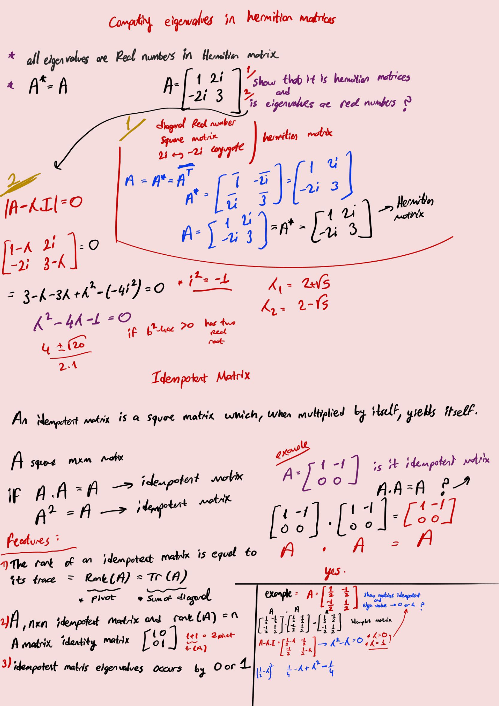

# Special Matrices

handwritten notes and derivations for complex matrices, conjugate transpose, unitary matrices, hermitian matrices and idempotent projection matrices

[download full notes pdf](./special-matrices.pdf) | [runnable script: src/special_matrices.py](./src/special_matrices.py)

---

## Complex Matrices and Conjugate Transpose

definition of real and complex matrices, conjugate transpose properties, and product conjugate rules

$$
A^* = \overline{A^T} \quad \text{and} \quad (AB)^* = B^* A^*
$$



### Computational Verification

```python
# conjugate transpose product rule: (AB)* == B* @ A*
left_star = (A @ B).conj().T
right_star = B.conj().T @ A.conj().T
assert np.allclose(left_star, right_star)
```

```text
conjugate transpose property holds: (AB)* == B* @ A*
```

---

## Unitary Matrices

properties of unitary matrices where the inverse equals the conjugate transpose, preserving inner products and vector norms

$$
U^* U = U U^* = I \iff U^{-1} = U^*
$$



### Computational Verification

```python
# unitary matrix verification: U* @ U == I
U = 0.5 * np.array([[1 + 1j, 1 - 1j], 
                    [1 - 1j, 1 + 1j]])
assert np.allclose(U.conj().T @ U, np.eye(2))
```

```text
U* @ U:
 [[1.+0.j 0.+0.j]
 [0.+0.j 1.+0.j]]
U is unitary: U* @ U == I
```

---

## Hermitian Matrices and Real Eigenvalues

square complex matrices equal to their own conjugate transpose, with diagonal elements strictly real and guaranteed purely real eigenvalues

$$
H^* = H \implies \lambda_i \in \mathbb{R} \quad \forall i
$$




### Computational Verification

```python
# hermitian matrix: H == H* and real eigenvalues (2 ± sqrt(5))
H = np.array([[1, 2j], 
              [-2j, 3]])
assert np.allclose(H, H.conj().T)

eigenvalues, _ = np.linalg.eig(H)
assert np.all(np.isreal(eigenvalues))
```

```text
eigenvalues of H: [-0.23606798+0.j  4.23606798+0.j]
H is hermitian and all eigenvalues are real: 2 ± sqrt(5)
```

---

## Idempotent Matrices

projection matrices that remain unchanged when multiplied by themselves, with eigenvalues strictly restricted to zero or one and rank equal to trace

$$
M^2 = M \implies \lambda \in \{0, 1\} \quad \text{and} \quad \text{rank}(M) = \text{tr}(M)
$$

### Computational Verification

```python
# idempotent matrix: M^2 == M, rank == trace, eigenvalues in {0, 1}
M = 0.5 * np.array([[1.0, 1.0], 
                    [1.0, 1.0]])
assert np.allclose(M @ M, M)

eigenvalues_M, _ = np.linalg.eig(M)
rank_M = np.linalg.matrix_rank(M)
trace_M = int(np.round(np.trace(M)))
assert rank_M == trace_M
```

```text
M^2:
 [[0.5 0.5]
 [0.5 0.5]]
eigenvalues of M: [1. 0.]
rank = 1, trace = 1
M is idempotent: M^2 == M and eigenvalues are 0 and 1
```

---

## Real-World and Robotics Applications

where special matrices run inside real robotics, signal processing and quantum systems code:

- **radar and uav communication (i/q complex processing)**: drone rf telemetry and radar signals are sampled as in-phase and quadrature complex vectors $(I + jQ)$. channel estimation and beamforming matrices rely on conjugate transpose operations $A^*$ to compute optimal antenna gains.
- **unitary transformations in quantum robotics and rotations**: unitary matrices preserve the euclidean norm, $(\|Ux\| = \|x\|)$, ensuring that physical energy or probability amplitude is conserved. all quantum computing logic gates and high-dimensional state rotations are unitary.
- **hermitian matrices in sensor covariance and spectral estimation**: covariance matrices of complex sensory data are hermitian. because their eigenvalues are guaranteed to be purely real $(\lambda \in \mathbb{R})$, sensor uncertainty and power spectral density can always be physically interpreted as real positive energy.
- **idempotent projection matrices in slam and least squares**: in robotic state estimation and visual slam, projecting high-dimensional observations onto a lower-dimensional constraint subspace uses projection matrices $P = A(A^T A)^{-1} A^T$. applying the projection twice changes nothing $(P^2 = P)$, which is the exact definition of an idempotent matrix.
