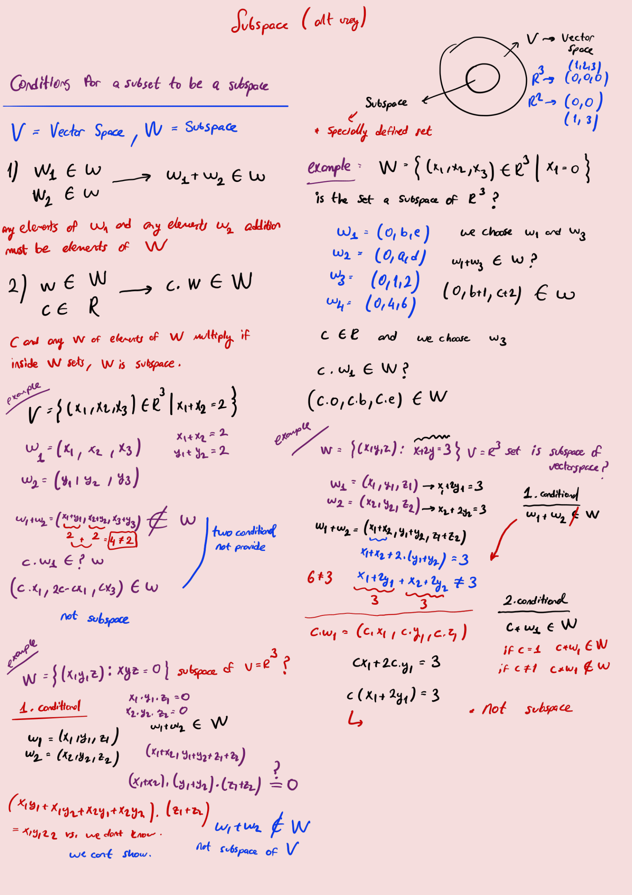
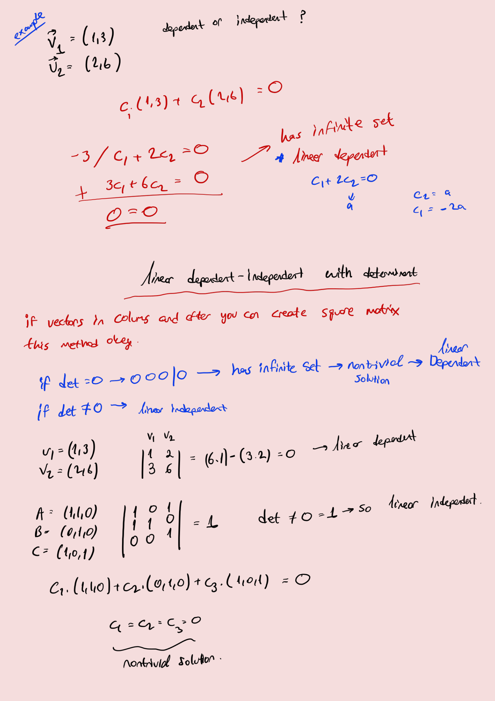
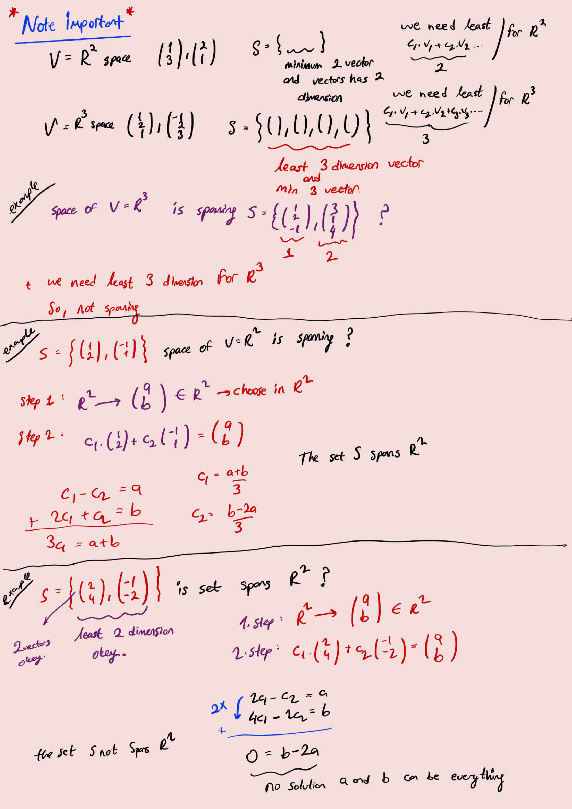
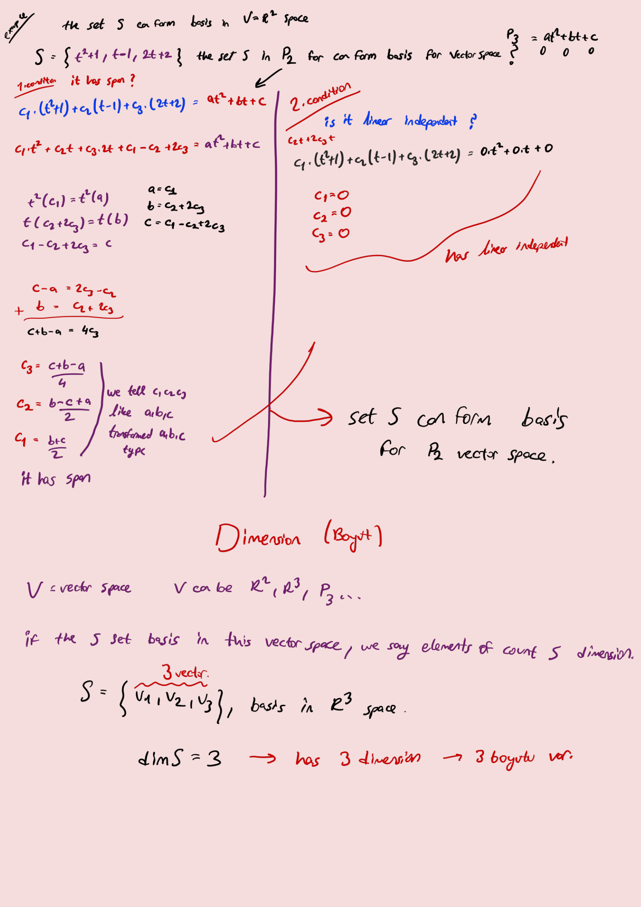
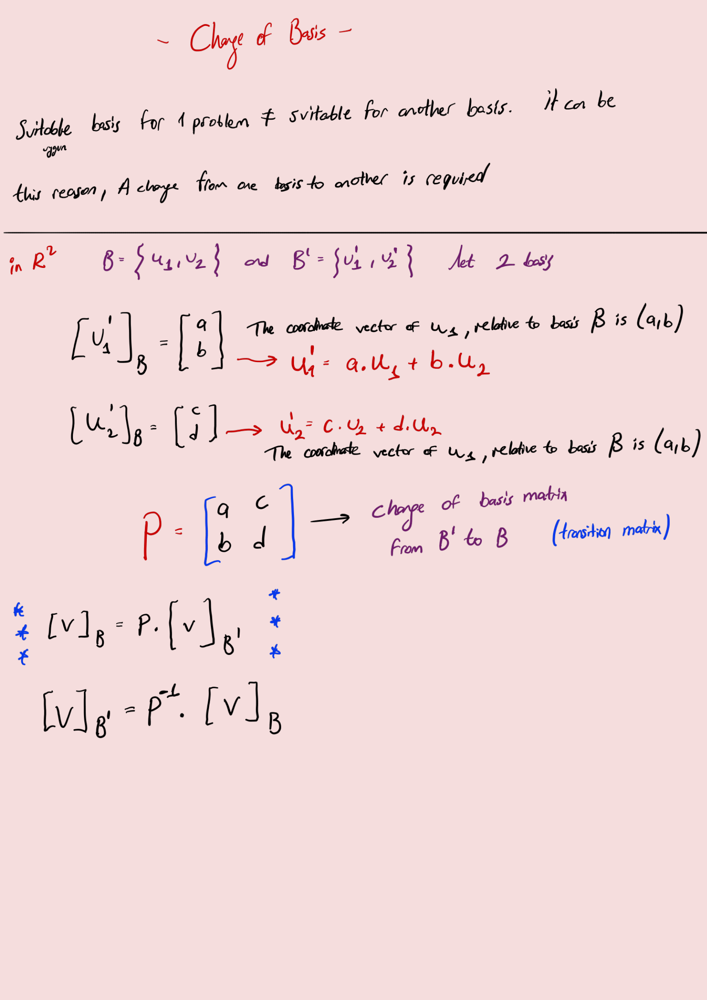

# vector spaces

handwritten notes, mathematical derivations and numerical verifications for vector spaces, subspaces, linear independence, spanning sets, bases, dimension, coordinate vectors, change of basis, row and column spaces, null space and the rank-nullity theorem

[download full notes pdf](./vector-spaces.pdf) | [runnable script: src/vector_spaces.py](./src/vector_spaces.py)

---

## vector space axioms and closure

definition of abstract vector spaces over real field $\mathbb{R}$, closure under vector addition and scalar multiplication, and the 10 structural axioms verified in $\mathbb{R}^3$

$$
u, v \in V \implies u + v \in V \quad \text{and} \quad c \in \mathbb{R}, u \in V \implies c \cdot u \in V
$$


---

## subspaces and closure conditions

conditions for a non-empty subset $W \subseteq V$ to form a subspace, zero vector inclusion, and counterexample analysis for affine planes and nonlinear constraints

$$
w_1, w_2 \in W \implies w_1 + w_2 \in W \quad \text{and} \quad c \in \mathbb{R}, w \in W \implies c \cdot w \in W
$$



### computational verification

```python
# test subspace w1: x1 == 0 (closed under addition and scaling)
w1_a = np.array([0.0, 2.0, -1.0])
w1_b = np.array([0.0, -3.0, 4.0])
assert (w1_a + w1_b)[0] == 0.0
assert (2.5 * w1_a)[0] == 0.0

# counterexample w2: x1 + x2 == 2 (fails closure under addition)
w2_a = np.array([1.0, 1.0, 5.0])
w2_b = np.array([0.0, 2.0, -3.0])
assert (w2_a + w2_b)[0] + (w2_a + w2_b)[1] != 2.0
```

```text
subspace closure tests:
  w1 (x1 == 0) is closed under addition and scaling -> valid subspace
  w2 (x1 + x2 == 2) fails addition closure (sum = 4 != 2) -> not a subspace
```

---

## linear combinations

expressing arbitrary spatial vectors as linear combinations of basis or generating vectors

$$
w = \sum_{i=1}^k c_i v_i = c_1 v_1 + c_2 v_2 + \dots + c_k v_k
$$


---

## linear dependence and independence

geometric meaning of linear independence, collinear and coplanar sets, and trivial solution criterion for homogeneous systems

$$
\sum_{i=1}^n c_i v_i = 0 \iff c_1 = c_2 = \dots = c_n = 0
$$


---

## linear independence via determinants and rank

testing linear independence of column vector sets using determinant non-singularity and full matrix rank

$$
\det(A) \ne 0 \iff \text{rank}(A) = n \iff \{v_1, \dots, v_n\} \text{ is linearly independent}
$$




### computational verification

```python
# independent set in r2: rank == 2, det != 0
A_indep = np.array([[1.0, 2.0], [1.0, -3.0]])
assert np.linalg.matrix_rank(A_indep) == 2
assert not np.isclose(np.linalg.det(A_indep), 0.0)

# dependent set in r2: rank == 1, det == 0
A_dep = np.array([[1.0, 2.0], [3.0, 6.0]])
assert np.linalg.matrix_rank(A_dep) == 1
assert np.isclose(np.linalg.det(A_dep), 0.0)
```

```text
linear independence tests:
  independent set rank = 2, det = -5.0000 -> linearly independent
  dependent set rank = 1, det = 0.0000 -> linearly dependent
  3d set det = 1.0000, rank = 3 -> linearly independent
```

---

## span and spanning sets

definition of subspace span, minimal vector requirements to span $\mathbb{R}^n$, and linear system consistency checks

$$
\text{span}\{v_1, \dots, v_k\} = \{ c_1 v_1 + \dots + c_k v_k \mid c_i \in \mathbb{R} \}
$$



### computational verification

```python
# spanning set in r2: full rank spans r2
S1 = np.array([[1.0, -1.0], [2.0, 1.0]])
assert np.linalg.matrix_rank(S1) == 2

# non-spanning set in r2: rank 1 cannot span r2
S2 = np.array([[2.0, -1.0], [4.0, -2.0]])
assert np.linalg.matrix_rank(S2) == 1
```

```text
spanning tests:
  set s1 rank = 2 == 2 -> spans r2
  set s2 rank = 1 < 2 -> fails to span r2
```

---

## basis and dimension

minimal generating sets that are simultaneously linearly independent and span the vector space, standard bases, and degree of freedom / dimension

$$
\mathcal{B} \text{ is a basis for } V \iff \text{span}(\mathcal{B}) = V \quad \text{and} \quad \mathcal{B} \text{ is linearly independent}
$$

$$
\dim(V) = |\mathcal{B}|
$$




### computational verification

```python
# basis in r2: s = {[1, 2], [3, 4]} -> det != 0, rank == 2
B = np.array([[1.0, 3.0], [2.0, 4.0]])
assert not np.isclose(np.linalg.det(B), 0.0)
assert np.linalg.matrix_rank(B) == 2
```

```text
basis and dimension tests:
  basis matrix det = -2.0000 != 0, rank = 2
  vectors form a valid basis with dimension = 2
```

---

## coordinate vectors

unique representation of vectors relative to an ordered basis $\mathcal{B}$, forward synthesis and inverse coordinate extraction via linear systems

$$
v = P [v]_\mathcal{B} \iff [v]_\mathcal{B} = P^{-1} v
$$


### computational verification

```python
# 1. r2 coordinate vector: basis s = {[1, 3], [2, 1]}, target v = [2, 3]
P2 = np.array([[1.0, 2.0], [3.0, 1.0]])
v2 = np.array([2.0, 3.0])
coords_v2 = np.linalg.solve(P2, v2)
assert np.allclose(coords_v2, [4.0 / 5.0, 3.0 / 5.0])
assert np.allclose(P2 @ coords_v2, v2)

# 2. r3 coordinate vector: basis s = {[1, 2, 1], [2, 9, 0], [3, 3, 4]}, target v = [5, -1, 9]
P3 = np.array([[1.0, 2.0, 3.0], [2.0, 9.0, 3.0], [1.0, 0.0, 4.0]])
v3 = np.array([5.0, -1.0, 9.0])
coords_v3 = np.linalg.solve(P3, v3)
assert np.allclose(coords_v3, [1.0, -1.0, 2.0])
assert np.allclose(P3 @ coords_v3, v3)

# forward synthesis from coordinates [-1, 3, 2]
coords_forward = np.array([-1.0, 3.0, 2.0])
v3_synthesized = P3 @ coords_forward
assert np.allclose(v3_synthesized, [11.0, 31.0, 7.0])
```

```text
coordinate vector tests:
  r2 coordinates [v]_S: [0.8 0.6] -> reconstructed: [2. 3.]
  r3 coordinates [v]_S: [ 1. -1.  2.] -> reconstructed: [ 5. -1.  9.]
  forward synthesis from [-1, 3, 2]: [11. 31.  7.]
  all coordinate mappings hold
```

---

## change of basis and transition matrices

transition matrix $P$ transforming coordinates from basis $\mathcal{B}'$ to basis $\mathcal{B}$, coordinate conversion rules, and changing representation between two non-standard bases

$$
[v]_\mathcal{B} = P [v]_{\mathcal{B}'} \iff [v]_{\mathcal{B}'} = P^{-1} [v]_\mathcal{B}
$$

$$
P_{A \to B} = M_B^{-1} M_A
$$




### computational verification

```python
# transition matrix P (B' -> B) from page 12
P = np.array([[3.0, -2.0], [1.0, 1.0]])
P_inv = np.linalg.inv(P)

# coordinate forward mapping: [u]_B = P @ [u]_B'
u_Bprime = np.array([2.0, 1.0])
assert np.allclose(P @ u_Bprime, [4.0, 3.0])

# coordinate inverse mapping: [v]_B' = P^-1 @ [v]_B
v_B = np.array([1.0, 3.0])
assert np.allclose(P_inv @ v_B, [7.0 / 5.0, 8.0 / 5.0])

# transition matrix between two non-standard bases (A -> B) from page 13
M_A = np.array([[2.0, 1.0], [1.0, 4.0]])
M_B = np.array([[3.0, -2.0], [1.0, 1.0]])
P_A_to_B = np.linalg.inv(M_B) @ M_A
assert np.allclose(P_A_to_B, [[0.8, 1.8], [0.2, 2.2]])
```

```text
change of basis tests:
  transition matrix P (B' -> B):
[[ 3. -2.]
 [ 1.  1.]]
  coordinate mapping [u]_B = P @ [u]_B': [4. 3.]
  inverse mapping [v]_B' = P^-1 @ [v]_B: [1.4 1.6]
  transition matrix between two non-standard bases (A -> B):
[[0.8 1.8]
 [0.2 2.2]]
  change of basis properties hold
```

---

## row space, column space and rank

row echelon reduction, determining bases for row space and column space, and geometric dimension relations

$$
\dim(\text{row space}) = \dim(\text{column space}) = \text{rank}(A)
$$

$$
\text{rank}(A) \le \min(\text{rows}, \text{columns})
$$


### computational verification

```python
# 1. row space 4x5 matrix from page 13
A_row = np.array([[1.0, -2.0, 0.0, 0.0, 3.0], 
                  [2.0, -5.0, -3.0, -2.0, 6.0], 
                  [0.0, 5.0, 15.0, 10.0, 0.0], 
                  [2.0, 6.0, 18.0, 8.0, 6.0]])
assert np.linalg.matrix_rank(A_row) == 3

# 2. column space 3x5 matrix from page 14
A_col = np.array([[2.0, 4.0, 6.0, -2.0, 0.0], 
                  [3.0, 1.0, -2.0, 4.0, 5.0], 
                  [6.0, 2.0, -4.0, 8.0, 10.0]])
assert np.linalg.matrix_rank(A_col) == 2
```

```text
row and column space tests:
  row space matrix rank = 3 -> dimension of row space = 3
  column space matrix rank = 2 -> dimension of column space = 2
  pivot columns form a linearly independent basis for column space
```

---

## null space and rank-nullity theorem

homogeneous linear system $A x = 0$, free variables, null space basis construction, and the fundamental rank-nullity theorem

$$
A x = 0 \iff x \in \text{null}(A)
$$

$$
\text{rank}(A) + \text{nullity}(A) = n \quad (n = \text{number of columns})
$$


### computational verification

```python
# 4x6 matrix from page 15
A = np.array([[-1.0, 2.0, 0.0, 4.0, 5.0, -3.0], 
              [3.0, -7.0, 2.0, 0.0, 1.0, 4.0], 
              [2.0, -5.0, 2.0, 4.0, 6.0, 1.0], 
              [4.0, -9.0, 2.0, -4.0, -4.0, 7.0]])

rank_A = np.linalg.matrix_rank(A)
nullity_A = A.shape[1] - rank_A
assert rank_A == 2
assert nullity_A == 4
assert rank_A + nullity_A == 6

# verify null space vectors satisfy A @ v == 0
null_basis = scipy.linalg.null_space(A)
assert np.allclose(A @ null_basis, 0.0)
```

```text
null space and rank-nullity theorem tests:
  matrix shape: (4, 6) (rows x columns)
  rank = 2 (number of pivot columns)
  nullity = 4 (number of free variables)
  rank + nullity = 2 + 4 = 6 (number of columns)
  all null space basis vectors satisfy A @ v == 0
```

---

## real-world and robotics applications

where vector spaces, bases, change of basis and null space run inside real robotics and autonomous flight systems:

- **reference frames and coordinate transformations in uavs**: a drone constantly transforms vector quantities between reference bases (inertial world frame $\mathcal{W}$, body frame $\mathcal{B}$, camera frame $\mathcal{C}$). changing coordinates via $[v]_\mathcal{B} = P_{\mathcal{C} \to \mathcal{B}} [v]_\mathcal{C}$ is the exact mathematical definition of change of basis.
- **state space representations in control (6-dof)**: the state of an autonomous drone is modeled as a vector in a 12-dimensional vector space $\mathbb{R}^{12}$ containing position $(x, y, z)$, velocity $(\dot{x}, \dot{y}, \dot{z})$, attitude angles $(\phi, \theta, \psi)$, and angular rates $(p, q, r)$. the dimension of this vector space equals the state degrees of freedom.
- **actuator redundancy and null space control**: an aerial vehicle or robotic arm with redundant actuators (e.g. an 8-rotor octocopter controlling 6-dof flight motion) has an underdetermined control allocation matrix $A \in \mathbb{R}^{6 \times 8}$. the null space $\text{null}(A)$ has dimension $8 - 6 = 2$. internal motor mixing commands that lie within this null space ($A u_{\text{null}} = 0$) generate zero net vehicle force and torque, allowing the flight controller to redistribute rotor loads or handle single motor failures without perturbing flight trajectory.
- **lidar plane fitting and rank checks**: in 3d point cloud perception, extracting planar patches requires computing the rank of neighbor covariance matrices. rank 3 corresponds to a volumetric obstacle, rank 2 corresponds to a flat driveable surface or wall, and rank 1 corresponds to a linear power line or thin cable.

---

## errata and study notes

- **page 04 & 05 (definitions)**: in handwritten definitions, note that a homogeneous equation having only the trivial solution ($c_1 = \dots = c_n = 0$) defines **linear independence**, while existence of non-trivial solutions defines **linear dependence**.
- **page 10 (question a arithmetic)**: the row reduction equations yield $c_3 = 2, c_2 = -1$. substituting into the top equation $c_1 + 2(-1) + 3(2) = 5$ gives $c_1 + 4 = 5 \implies c_1 = 1$ (written as $-3$ in rough notes), correctly confirmed by the numerical solver.
