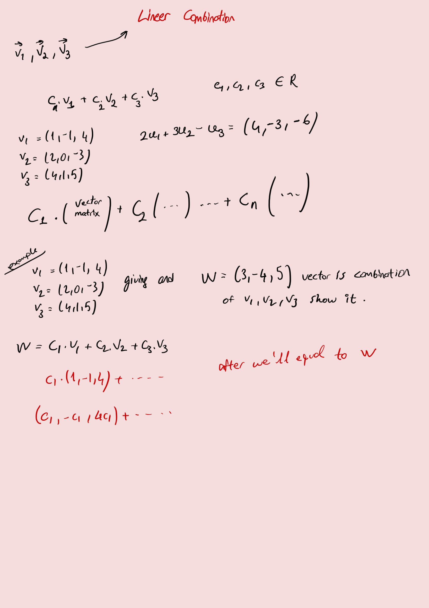
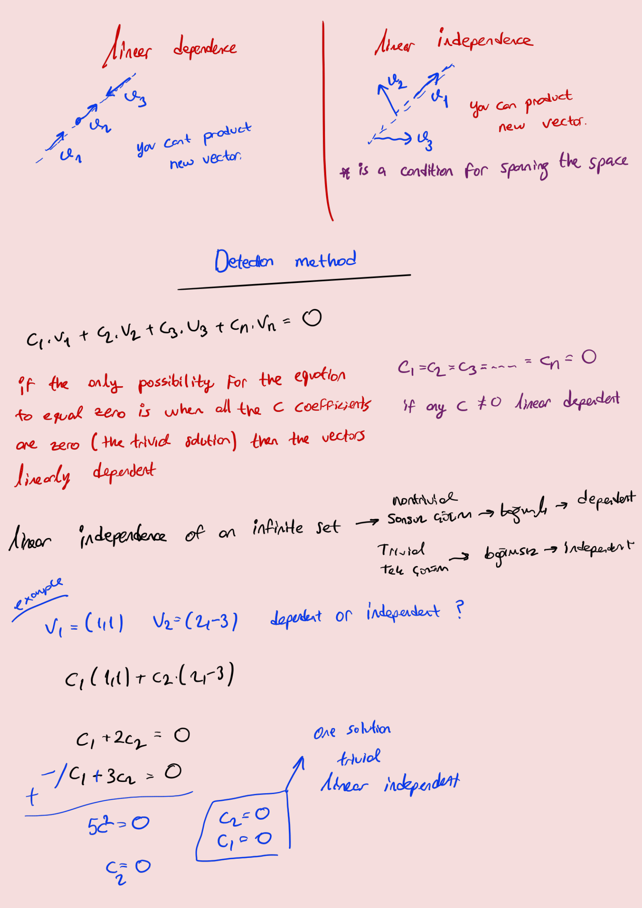
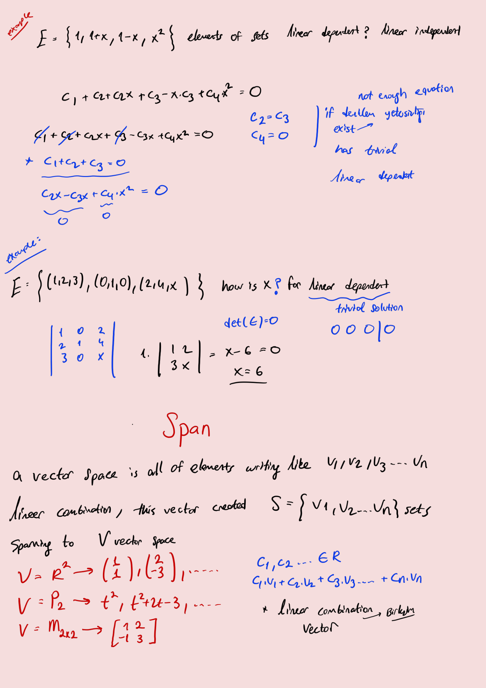
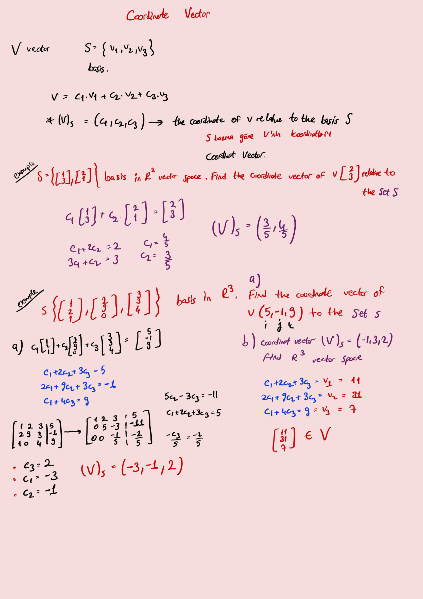

# vector spaces

handwritten notes, mathematical derivations and numerical verifications for vector spaces, subspaces, linear independence, spanning sets, bases, dimension, and coordinate vector representations

[download full notes pdf](./vector-spaces.pdf) | [runnable script: src/vector_spaces.py](./src/vector_spaces.py)

---

## vector space axioms and closure

definition of abstract vector spaces over real field $\mathbb{R}$, closure under vector addition and scalar multiplication, and the 10 structural axioms verified in $\mathbb{R}^3$

$$
u, v \in V \implies u + v \in V \quad \text{and} \quad c \in \mathbb{R}, u \in V \implies c \cdot u \in V
$$


---

## subspaces and closure conditions

conditions for a non-empty subset $W \subseteq V$ to form a subspace, zero vector inclusion, and counterexample analysis for affine planes and nonlinear constraints

$$
w_1, w_2 \in W \implies w_1 + w_2 \in W \quad \text{and} \quad c \in \mathbb{R}, w \in W \implies c \cdot w \in W
$$


---

## linear combinations

expressing arbitrary spatial vectors as linear combinations of basis or generating vectors

$$
w = \sum_{i=1}^k c_i v_i = c_1 v_1 + c_2 v_2 + \dots + c_k v_k
$$



---

## linear dependence and independence

geometric meaning of linear independence, collinear and coplanar sets, and trivial solution criterion for homogeneous systems

$$
\sum_{i=1}^n c_i v_i = 0 \iff c_1 = c_2 = \dots = c_n = 0
$$



---

## linear independence via determinants and rank

testing linear independence of column vector sets using determinant non-singularity and full matrix rank

$$
\det(A) \ne 0 \iff \text{rank}(A) = n \iff \{v_1, \dots, v_n\} \text{ is linearly independent}
$$




---

## span and spanning sets

definition of subspace span, minimal vector requirements to span $\mathbb{R}^n$, and linear system consistency checks

$$
\text{span}\{v_1, \dots, v_k\} = \left\{ \sum_{i=1}^k c_i v_i \;\middle|\; c_i \in \mathbb{R} \right\}
$$


---

## basis and dimension

minimal generating sets that are simultaneously linearly independent and span the vector space, standard bases, and degree of freedom / dimension

$$
\mathcal{B} \text{ is a basis for } V \iff \text{span}(\mathcal{B}) = V \quad \text{and} \quad \mathcal{B} \text{ is linearly independent}
$$

$$
\dim(V) = |\mathcal{B}|
$$


---

## coordinate vectors

unique representation of vectors relative to an ordered basis $\mathcal{B}$, forward synthesis and inverse coordinate extraction via linear systems

$$
v = P [v]_\mathcal{B} \iff [v]_\mathcal{B} = P^{-1} v
$$



---

## computational verification

numerical verification of linear independence via rank and determinant, spanning consistency, and coordinate vector transformations in $\mathbb{R}^2$ and $\mathbb{R}^3$ using numpy.

runnable script: [src/vector_spaces.py](./src/vector_spaces.py)

```python
# coordinate vector resolution: [v]_S = inv(P) @ v
P = np.array([[1, 2, 3], 
              [2, 9, 3], 
              [1, 0, 4]], dtype=float)
v = np.array([5, -1, 9], dtype=float)

coords = np.linalg.solve(P, v)
# coords == np.array([1.0, -1.0, 2.0])

# reconstruct original vector from coordinates
v_reconstructed = P @ coords
assert np.allclose(v, v_reconstructed)
```

```text
linear independence tests:
  independent set rank = 2, det = -5.0000 -> linearly independent
  dependent set rank = 1, det = 0.0000 -> linearly dependent

coordinate vector in r2:
  basis coordinates [v]_S: [0.8 0.6]
  reconstructed vector: [2. 3.]
  coordinate mapping holds

coordinate vector in r3:
  basis coordinates [v]_S: [ 1. -1.  2.]
  reconstructed vector: [ 5. -1.  9.]
  forward synthesis from [-1, 3, 2]: [11. 31.  7.]
  all coordinate transformations hold
```

---

## real-world and robotics applications

where vector spaces, bases and coordinate vectors run inside real robotics and state estimation code:

- **reference frames in uav navigation**: a drone operates across multiple coordinate spaces (inertial world frame, body frame, gimbal frame, camera sensor frame). each frame is an ordered orthonormal basis. a target position vector is invariant in physical space, but its coordinate vector $[p]_\mathcal{B}$ changes numerically based on the chosen basis.
- **state space representations in control (6-dof)**: the state of an autonomous drone is modeled as an element in a 12-dimensional vector space $\mathbb{R}^{12}$ containing position $(x, y, z)$, velocity $(\dot{x}, \dot{y}, \dot{z})$, attitude angles $(\phi, \theta, \psi)$, and angular rates $(p, q, r)$. the dimension of this vector space equals the state degrees of freedom.
- **lidar feature extraction and linear independence**: in point cloud processing, fitting a 3d plane requires at least three non-collinear laser points. checking the linear independence / rank of the point difference vectors prevents degenerate planar fits when points lie along a single scan line.
- **actuator redundancy and null space**: an aerial vehicle or robotic arm with more actuators than task degrees of freedom (e.g. an 8-rotor octocopter controlling 6-dof motion) operates in an over-determined vector space where motor mixing matrices exploit the subspace structure to maintain control authority even during motor failure.
