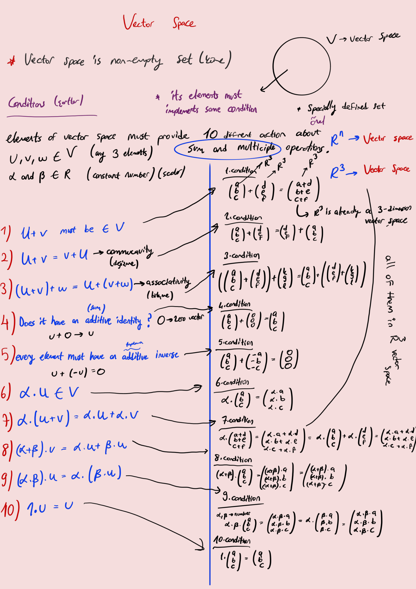
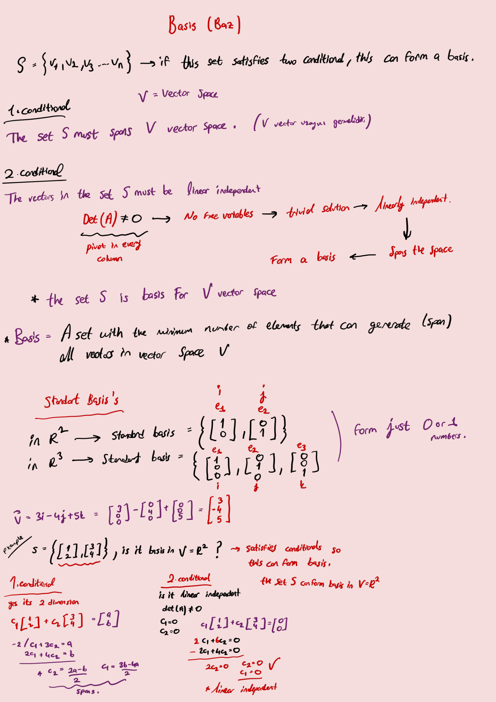
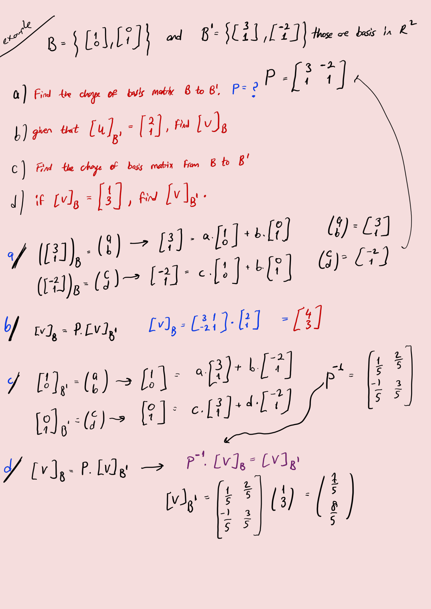
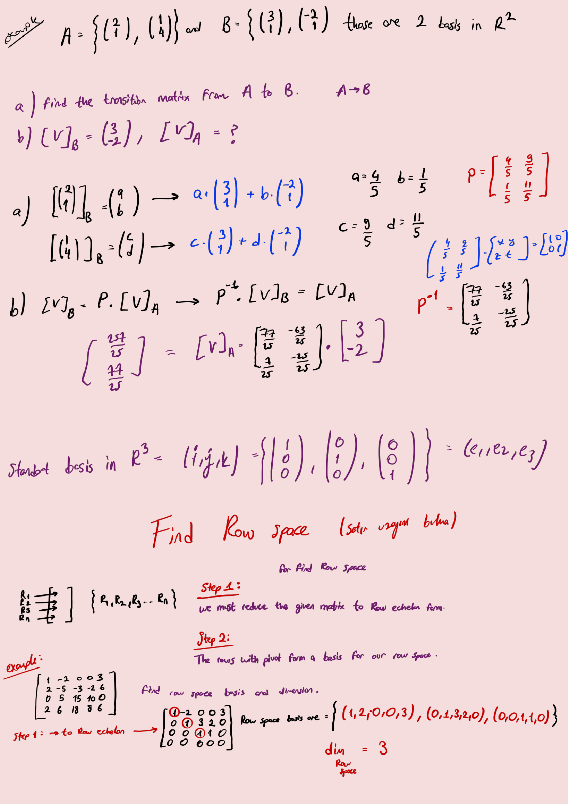
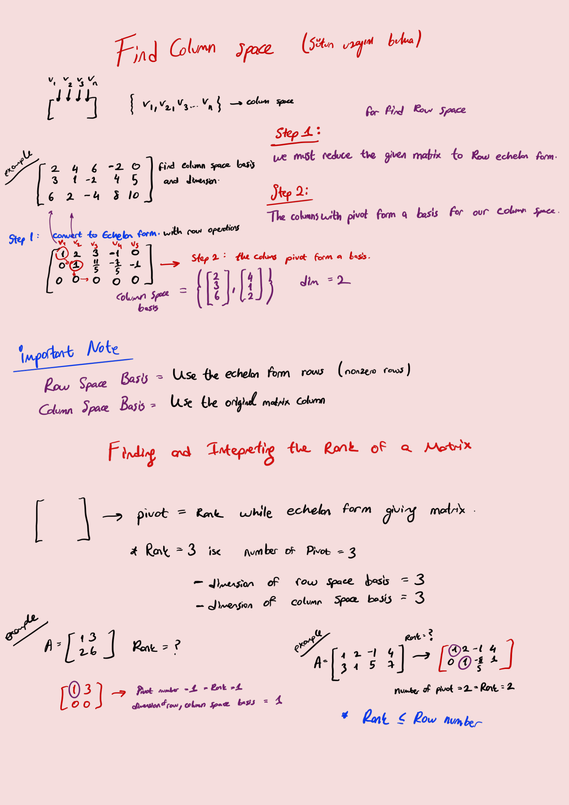
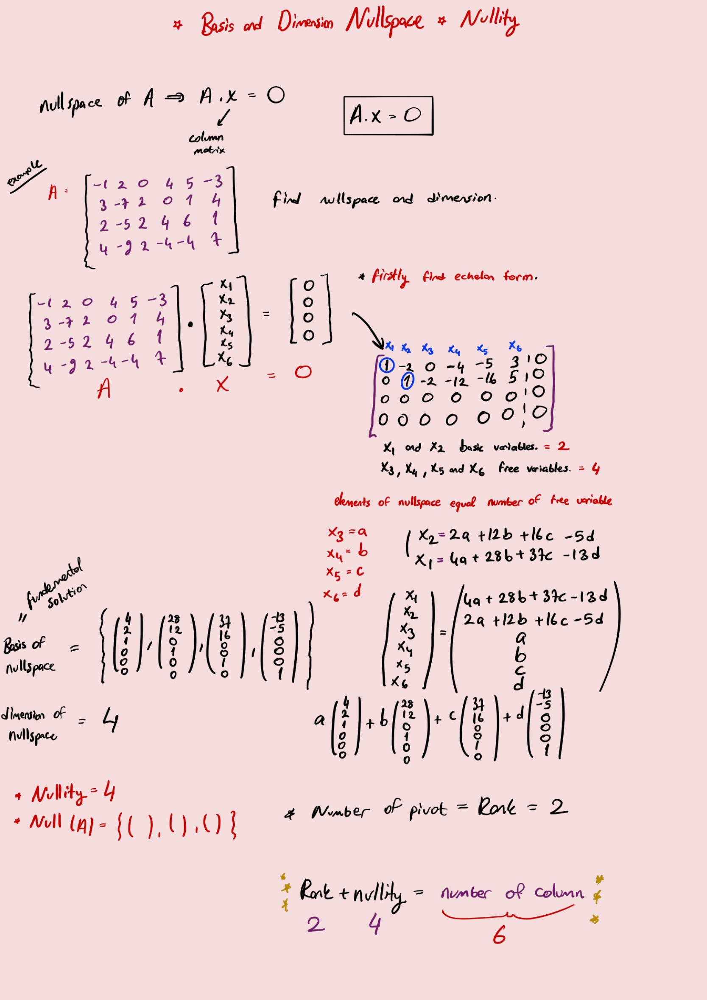

# vector spaces

handwritten notes, mathematical derivations and numerical verifications for vector spaces, subspaces, linear independence, spanning sets, bases, dimension, coordinate vectors, change of basis, row and column spaces, null space and the rank-nullity theorem

[download full notes pdf](./vector-spaces.pdf) | [runnable script: src/vector_spaces.py](./src/vector_spaces.py)

---

## vector space axioms and closure

definition of abstract vector spaces over real field $\mathbb{R}$, closure under vector addition and scalar multiplication, and the 10 structural axioms verified in $\mathbb{R}^3$

$$
u, v \in V \implies u + v \in V \quad \text{and} \quad c \in \mathbb{R}, u \in V \implies c \cdot u \in V
$$



---

## subspaces and closure conditions

conditions for a non-empty subset $W \subseteq V$ to form a subspace, zero vector inclusion, and counterexample analysis for affine planes and nonlinear constraints

$$
w_1, w_2 \in W \implies w_1 + w_2 \in W \quad \text{and} \quad c \in \mathbb{R}, w \in W \implies c \cdot w \in W
$$


### computational verification

```python
# subspace W1: x1 = 0 (plane passing through origin)
w1_a = np.array([0.0, 2.0, -1.0])
w1_b = np.array([0.0, -3.0, 4.0])
w1_sum = w1_a + w1_b

# non-subspace W2: x1 + x2 = 2 (plane not passing through origin)
w2_a = np.array([1.0, 1.0, 5.0])
w2_b = np.array([0.0, 2.0, -3.0])
w2_sum = w2_a + w2_b

print("W1 (x1 = 0) closed under addition:", w1_sum[0] == 0.0)
print("W2 (x1 + x2 = 2) closed under addition:", (w2_sum[0] + w2_sum[1]) == 2.0)
```

```text
W1 (x1 = 0) closed under addition: True
W2 (x1 + x2 = 2) closed under addition: False
```

---

## linear combinations

expressing arbitrary spatial vectors as linear combinations of basis or generating vectors

$$
w = \sum_{i=1}^k c_i v_i = c_1 v_1 + c_2 v_2 + \dots + c_k v_k
$$


---

## linear dependence and independence

geometric meaning of linear independence, collinear and coplanar sets, and trivial solution criterion for homogeneous systems

$$
\sum_{i=1}^n c_i v_i = 0 \iff c_1 = c_2 = \dots = c_n = 0
$$


---

## linear independence via determinants and rank

testing linear independence of column vector sets using determinant non-singularity and full matrix rank

$$
\det(A) \ne 0 \iff \text{rank}(A) = n \iff \{v_1, \dots, v_n\} \text{ is linearly independent}
$$


### computational verification

```python
# independent set in r2: rank == 2, det != 0
A_indep = np.array([[1.0, 2.0], [1.0, -3.0]])
rank_indep = np.linalg.matrix_rank(A_indep)
det_indep = np.linalg.det(A_indep)

# dependent set in r2: rank == 1, det == 0
A_dep = np.array([[1.0, 2.0], [3.0, 6.0]])
rank_dep = np.linalg.matrix_rank(A_dep)
det_dep = np.linalg.det(A_dep)

print("independent set rank:", rank_indep, "det:", round(det_indep, 2))
print("dependent set rank:", rank_dep, "det:", round(det_dep, 2))
```

```text
independent set rank: 2 det: -5.0
dependent set rank: 1 det: 0.0
```

---

## span and spanning sets

definition of subspace span, minimal vector requirements to span $\mathbb{R}^n$, and linear system consistency checks

$$
\text{span}\{v_1, \dots, v_k\} = \{ c_1 v_1 + \dots + c_k v_k \mid c_i \in \mathbb{R} \}
$$


### computational verification

```python
# spanning set S1 in r2: full rank (rank == 2) spans r2
S1 = np.array([[1.0, -1.0], [2.0, 1.0]])
rank_S1 = np.linalg.matrix_rank(S1)

# non-spanning set S2 in r2: rank 1 cannot span r2
S2 = np.array([[2.0, -1.0], [4.0, -2.0]])
rank_S2 = np.linalg.matrix_rank(S2)

print("set S1 rank:", rank_S1, "spans r2:", rank_S1 == 2)
print("set S2 rank:", rank_S2, "spans r2:", rank_S2 == 2)
```

```text
set S1 rank: 2 spans r2: True
set S2 rank: 1 spans r2: False
```

---

## basis and dimension

minimal generating sets that are simultaneously linearly independent and span the vector space, standard bases, and degree of freedom / dimension

$$
\mathcal{B} \text{ is a basis for } V \iff \text{span}(\mathcal{B}) = V \quad \text{and} \quad \mathcal{B} \text{ is linearly independent}
$$

$$
\dim(V) = |\mathcal{B}|
$$




### computational verification

```python
# basis in r2: s = {[1, 2], [3, 4]} -> det != 0, rank == 2
B = np.array([[1.0, 3.0], [2.0, 4.0]])
det_B = np.linalg.det(B)
dim_B = np.linalg.matrix_rank(B)

print("basis matrix det:", round(det_B, 2))
print("basis dimension (rank):", dim_B)
print("forms valid basis:", dim_B == 2 and not np.isclose(det_B, 0.0))
```

```text
basis matrix det: -2.0
basis dimension (rank): 2
forms valid basis: True
```

---

## coordinate vectors

unique representation of vectors relative to an ordered basis $\mathcal{B}$, forward synthesis and inverse coordinate extraction via linear systems

$$
v = P [v]_\mathcal{B} \iff [v]_\mathcal{B} = P^{-1} v
$$


### computational verification

```python
# camera detected target [v]_C (2m right, 0m down, 5m forward)
v_cam = np.array([2.0, 0.0, 5.0])

# transition matrix P (camera -> body)
transition_matrix = np.array([[0.0, 0.0, 1.0],
                              [1.0, 0.0, 0.0],
                              [0.0, 1.0, 0.0]])

# forward transform: [v]_B = P @ [v]_C
v_body = transition_matrix @ v_cam

# inverse transform check: [v]_C = inv(P) @ [v]_B
p_inverse = np.linalg.inv(transition_matrix)
v_cam_recovered = p_inverse @ v_body

print("camera frame:", v_cam)
print("body frame (x: forward, y: right, z: down):", v_body)
print("reconstructed camera frame:", v_cam_recovered)
print("change of basis holds:", np.allclose(v_cam, v_cam_recovered))
```

```text
camera frame: [2. 0. 5.]
body frame (x: forward, y: right, z: down): [5. 2. 0.]
reconstructed camera frame: [2. 0. 5.]
change of basis holds: True
```

---

## change of basis and transition matrices

transition matrix $P$ transforming coordinates from basis $\mathcal{B}'$ to basis $\mathcal{B}$, coordinate conversion rules, and changing representation between two non-standard bases

$$
[v]_\mathcal{B} = P [v]_{\mathcal{B}'} \iff [v]_{\mathcal{B}'} = P^{-1} [v]_\mathcal{B}
$$

$$
P_{A \to B} = M_B^{-1} M_A
$$





### computational verification

```python
# sensor A (lidar basis) and sensor B (camera basis)
M_a = np.array([[2.0, 1.0], [1.0, 4.0]])
M_b = np.array([[3.0, -2.0], [1.0, 1.0]])

inv_M_b = np.linalg.inv(M_b)
transition_A_to_B = inv_M_b @ M_a

# coordinate vector in basis A transformed to basis B
x_a = np.array([2.0, 1.0])
x_b = transition_A_to_B @ x_a

print("transition matrix (A -> B):\n", np.round(transition_A_to_B, 2))
print("coordinates in basis B:", np.round(x_b, 2))
print("both bases represent same physical vector:", np.allclose(M_a @ x_a, M_b @ x_b))
```

```text
transition matrix (A -> B):
 [[0.8 1.8]
 [0.2 2.2]]
coordinates in basis B: [3.4 2.6]
both bases represent same physical vector: True
```

---

## row space, column space and rank

row echelon reduction, determining bases for row space and column space, and geometric dimension relations

$$
\dim(\text{row space}) = \dim(\text{column space}) = \text{rank}(A)
$$

$$
\text{rank}(A) \le \min(\text{rows}, \text{columns})
$$




### computational verification

```python
# last row is linear combination of first two rows (row3 = row1 + row2)
A = np.array([[1.0, 2.0, 0.0, 3.0],
              [0.0, 1.0, 1.0, 2.0],
              [1.0, 3.0, 1.0, 5.0]])

rank_A = np.linalg.matrix_rank(A)
column_space_dim = rank_A

# dynamic pivot column extraction using :rank_A
column_space_basis = A[:, :rank_A]
rank_basis = np.linalg.matrix_rank(column_space_basis)

print("matrix rank:", rank_A)
print("column space dimension:", column_space_dim)
print("column space basis columns:\n", column_space_basis)
print("basis rank:", rank_basis)
```

```text
matrix rank: 2
column space dimension: 2
column space basis columns:
 [[1. 2.]
 [0. 1.]
 [1. 3.]]
basis rank: 2
```

---

## null space and rank-nullity theorem

homogeneous linear system $A x = 0$, free variables, null space basis construction, and the fundamental rank-nullity theorem

$$
A x = 0 \iff x \in \text{null}(A)
$$

$$
\text{rank}(A) + \text{nullity}(A) = n \quad (n = \text{number of columns})
$$



### computational verification

```python
# hexacopter control allocation matrix B (4 outputs: thrust, roll, pitch, yaw from 6 motors)
B = np.array([[1.0, 1.0, 1.0, 1.0, 1.0, 1.0],
              [1.0, 0.5, -0.5, -1.0, -0.5, 0.5],
              [0.0, 1.0, 1.0, 0.0, -1.0, -1.0],
              [1.0, -1.0, 1.0, -1.0, 1.0, -1.0]])

rank_B = np.linalg.matrix_rank(B)
columns_B = B.shape[1]
nullity_B = columns_B - rank_B

# orthonormal basis for the null space (Ax = 0)
Z = null_space(B)

print("matrix B rank:", rank_B)
print("number of motors (columns):", columns_B)
print("nullity (free variables / degrees of redundancy):", nullity_B)
print("null space basis Z shape:", Z.shape)
print("B @ Z == 0 condition holds:", np.allclose(B @ Z, 0.0))

# motor 1 overheats: redistribute thrust using null space vector Z[:, 0]
u0 = np.array([5.0, 5.0, 5.0, 5.0, 5.0, 5.0])
y_initial = B @ u0
u_null = Z[:, 0] * 2.0
u_new = u0 + u_null
y_new = B @ u_new

print("baseline motor thrusts:", u0)
print("adjusted motor thrusts (motor 1 relieved):", np.round(u_new, 2))
print("net forces and torques preserved:", np.allclose(y_initial, y_new))
```

```text
matrix B rank: 4
number of motors (columns): 6
nullity (free variables / degrees of redundancy): 2
null space basis Z shape: (6, 2)
B @ Z == 0 condition holds: True
baseline motor thrusts: [5. 5. 5. 5. 5. 5.]
adjusted motor thrusts (motor 1 relieved): [4.22 6.13 4.65 4.22 6.13 4.65]
net forces and torques preserved: True
```

---

## real-world and robotics applications

where vector spaces, bases, change of basis and null space run inside real robotics and autonomous flight systems:

- **reference frames and coordinate transformations in uavs**: a drone constantly transforms vector quantities between reference bases (inertial world frame $\mathcal{W}$, body frame $\mathcal{B}$, camera frame $\mathcal{C}$). changing coordinates via:

$$
[v]_\mathcal{B} = P_{\mathcal{C} \to \mathcal{B}} [v]_\mathcal{C}
$$

  is the exact mathematical definition of change of basis. for example, transforming an obstacle vector detected in camera coordinates into body coordinates for collision avoidance.

- **state space representations in control (6-dof)**: the state of an autonomous drone is modeled as a vector in a 12-dimensional vector space:

$$
x = \begin{bmatrix} x & y & z & \dot{x} & \dot{y} & \dot{z} & \phi & \theta & \psi & p & q & r \end{bmatrix}^T \in \mathbb{R}^{12}
$$

  containing position $(x, y, z)$, velocity $(\dot{x}, \dot{y}, \dot{z})$, attitude angles $(\phi, \theta, \psi)$, and angular rates $(p, q, r)$. the dimension of this vector space equals the state degrees of freedom.

- **actuator redundancy and null space control**: an aerial vehicle or robotic arm with redundant actuators (e.g. an 8-rotor octocopter controlling 6-dof flight motion) has an underdetermined control allocation matrix $A \in \mathbb{R}^{6 \times 8}$. the null space $\text{null}(A)$ has dimension $8 - 6 = 2$:

$$
A u_{\text{null}} = 0
$$

  internal motor mixing commands that lie within this null space generate zero net vehicle force and torque, allowing the flight controller to redistribute rotor loads or handle single motor failures without perturbing flight trajectory.

- **lidar plane fitting and rank checks**: in 3d point cloud perception, extracting planar patches requires computing the rank of neighbor covariance matrices. rank 3 corresponds to a volumetric obstacle, rank 2 corresponds to a flat driveable surface or wall, and rank 1 corresponds to a linear power line or thin cable.

---

## errata and study notes

- **page 04 & 05 (definitions)**: in handwritten definitions, note that a homogeneous equation having only the trivial solution ($c_1 = \dots = c_n = 0$) defines **linear independence**, while existence of non-trivial solutions defines **linear dependence**.
- **page 10 (question a arithmetic)**: the row reduction equations yield $c_3 = 2, c_2 = -1$. substituting into the top equation $c_1 + 2(-1) + 3(2) = 5$ gives $c_1 + 4 = 5 \implies c_1 = 1$ (written as $-3$ in rough notes), correctly confirmed by the numerical solver.
