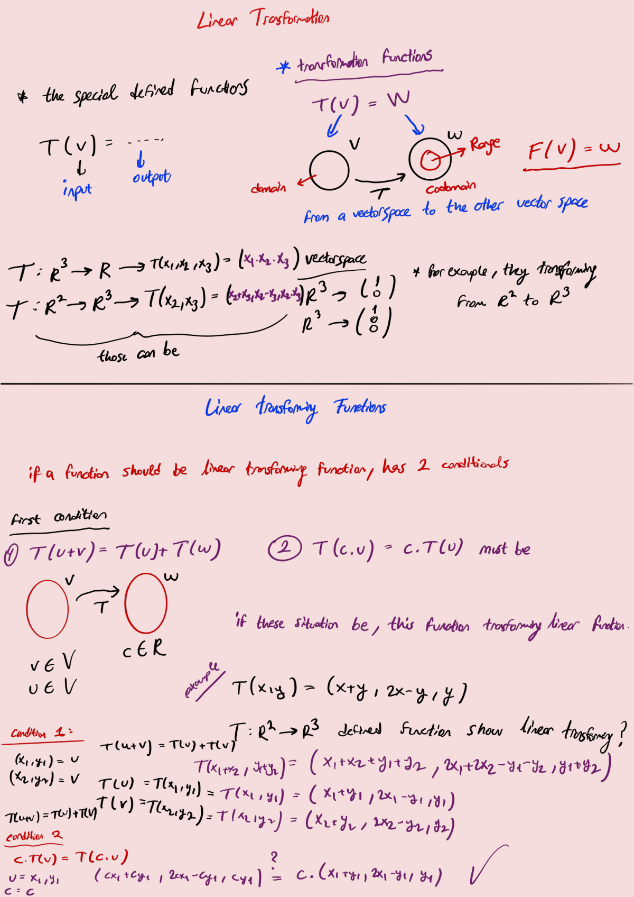

# linear transformations

handwritten notes, mathematical derivations and numerical verifications for linear transformation definitions, linearity conditions, standard transformation matrices, kernel (null space), range (column space), rank, nullity, and the rank-nullity theorem

[download full notes pdf](./linear-transformations.pdf) | [runnable script: src/linear_transformations.py](./src/linear_transformations.py)

---

## linear transformation definition and linearity conditions

mapping vectors between vector spaces $T: V \to W$ (domain, codomain, and range), and verifying the two fundamental linearity axioms: additivity and homogeneity (scalar multiplication)

$$
T(u + v) = T(u) + T(v) \quad \text{and} \quad T(c \cdot u) = c \cdot T(u) \quad \forall\, u, v \in V,\; c \in \mathbb{R}
$$



---

## linearity tests and standard transformation matrices

testing linear vs. nonlinear mappings and representing any linear transformation $T: \mathbb{R}^n \to \mathbb{R}^m$ as matrix-vector multiplication $T(u) = A u$, where $A \in \mathbb{R}^{m \times n}$

$$
T(u) = A u, \qquad A \in \mathbb{R}^{m \times n}, \; u \in \mathbb{R}^n, \; T(u) \in \mathbb{R}^m
$$


### computational verification

```python
u = np.array([2.0, -1.0])
v = np.array([-3.0, 4.0])
c = 3.0

def T1(vec):
    x, y = vec
    return np.array([x + y, 2 * x - y, y])

def T2(vec):
    x, y = vec
    return np.array([x * y, x - y])

t1_cond1 = np.allclose(T1(u + v), T1(u) + T1(v))
t1_cond2 = np.allclose(T1(c * u), c * T1(u))
print("T1 is linear:", t1_cond1 and t1_cond2)

t2_cond1 = np.allclose(T2(u + v), T2(u) + T2(v))
t2_cond2 = np.allclose(T2(c * u), c * T2(u))
print("T2 is linear:", t2_cond1 and t2_cond2)

def T_example(vec):
    x, y = vec
    return np.array([2 * x + y, y, x - 3 * y])

A = np.array([
    [2.0, 1.0],
    [0.0, 1.0],
    [1.0, -3.0]
])

func_out = T_example(u)
mat_out = A @ u

print("function output:", func_out)
print("matrix output:  ", mat_out)
print("T(u) == A @ u:  ", np.allclose(func_out, mat_out))
```

```text
T1 is linear: True
T2 is linear: False
function output: [ 3. -1.  5.]
matrix output:   [ 3. -1.  5.]
T(u) == A @ u:   True
```

---

## kernel (null space) of a linear transformation

recovering a transformation formula from its matrix $A$, and computing the kernel $\ker(T)$: the set of all domain vectors mapped to the zero vector in the codomain

$$
\ker(T) = \{ u \in V \mid T(u) = 0_W \}
$$


### computational verification

```python
# example a: L(x, y) = (2x - y, 3x + y) -> kernel = {(0, 0)}
L = np.array([
    [2.0, -1.0],
    [3.0, 1.0]
])
ker_L = null_space(L)
print("L nullity:", ker_L.shape[1])

# example b: T(x, y, z) = (x, y, 0) -> kernel = {(0, 0, z)}
P = np.array([
    [1.0, 0.0, 0.0],
    [0.0, 1.0, 0.0],
    [0.0, 0.0, 0.0]
])
ker_P = null_space(P)
print("P nullity:", ker_P.shape[1])
print("P kernel basis:", np.round(ker_P.ravel(), 2))
```

```text
L nullity: 0
P nullity: 1
P kernel basis: [0. 0. 1.]
```

---

## range (column space), rank, nullity and rank-nullity theorem

finding the range of $T(u) = A u$ via row echelon reduction and pivot columns of the original matrix $A$, and connecting rank and nullity to the domain dimension

$$
\text{range}(T) = \text{col}(A), \qquad \text{rank}(T) = \dim(\text{range}(T)), \qquad \text{nullity}(T) = \dim(\ker(T))
$$

$$
\text{rank}(T) + \text{nullity}(T) = \dim(V) = n
$$


### computational verification

```python
# T(x, y, z) = (x + y, y + z), T: R^3 -> R^2
M = np.array([
    [1.0, 1.0, 0.0],
    [0.0, 1.0, 1.0]
])

rank_M = np.linalg.matrix_rank(M)
ker_M = null_space(M)
nullity_M = ker_M.shape[1]
domain_dim = M.shape[1]

ker_basis = ker_M.ravel() / ker_M.ravel()[0]

print("rank:", rank_M)
print("nullity:", nullity_M)
print("rank + nullity == domain dim:", rank_M + nullity_M == domain_dim)
print("kernel basis:", np.round(ker_basis, 2))
print("M @ kernel == 0:", np.allclose(M @ ker_basis, 0.0))
```

```text
rank: 2
nullity: 1
rank + nullity == domain dim: True
kernel basis: [ 1. -1.  1.]
M @ kernel == 0: True
```

---

## real-world and robotics applications

where linear transformations, kernels, and ranges run directly inside robotics, computer vision, and autonomous flight:

- **3d rotations and camera projection**: rotating a point from camera frame to body frame via $v_b = R v_c$ is a length-preserving linear transformation with trivial kernel ($\ker(R) = \{0\}$). projecting 3d points onto a 2d image plane via a pinhole camera matrix $P \in \mathbb{R}^{3 \times 4}$ has a 1d kernel — the camera optical center — which is why depth is lost along each viewing ray.
- **robot manipulator jacobians**: the differential kinematics map $\dot{x} = J(q)\dot{q}$ is a linear transformation from joint velocities to end-effector velocities. the **range** of $J(q)$ gives the achievable end-effector motion directions, while the **kernel** $\ker(J)$ gives self-motion joint velocities that move the robot's links without moving the end-effector (used for obstacle avoidance in redundant arms).
- **linearized flight dynamics**: around a hover trim state, nonlinear quadrotor equations are approximated by the linear state-space map $\dot{x} = A x + B u$, where the column space of the controllability matrix determines which flight states are reachable.
