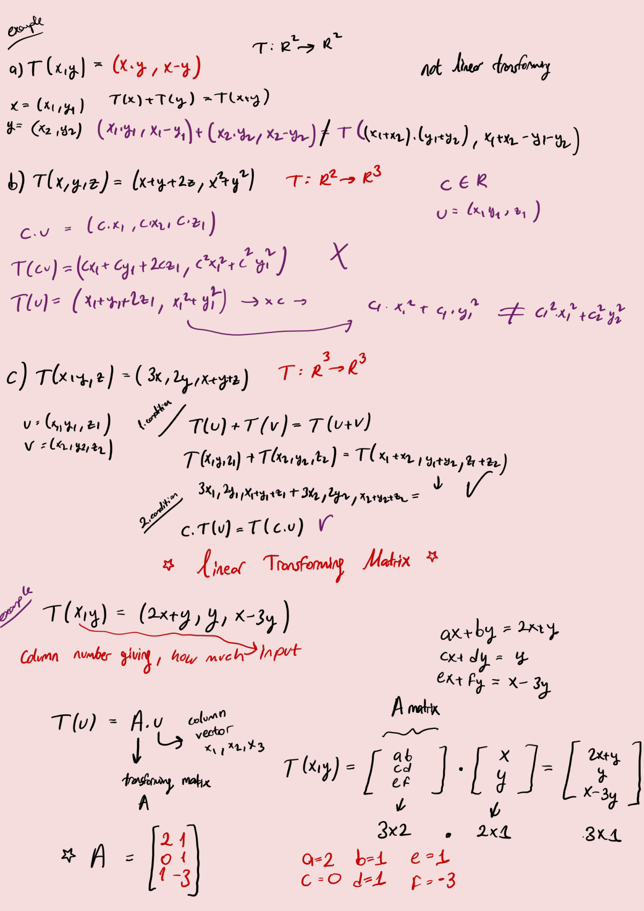
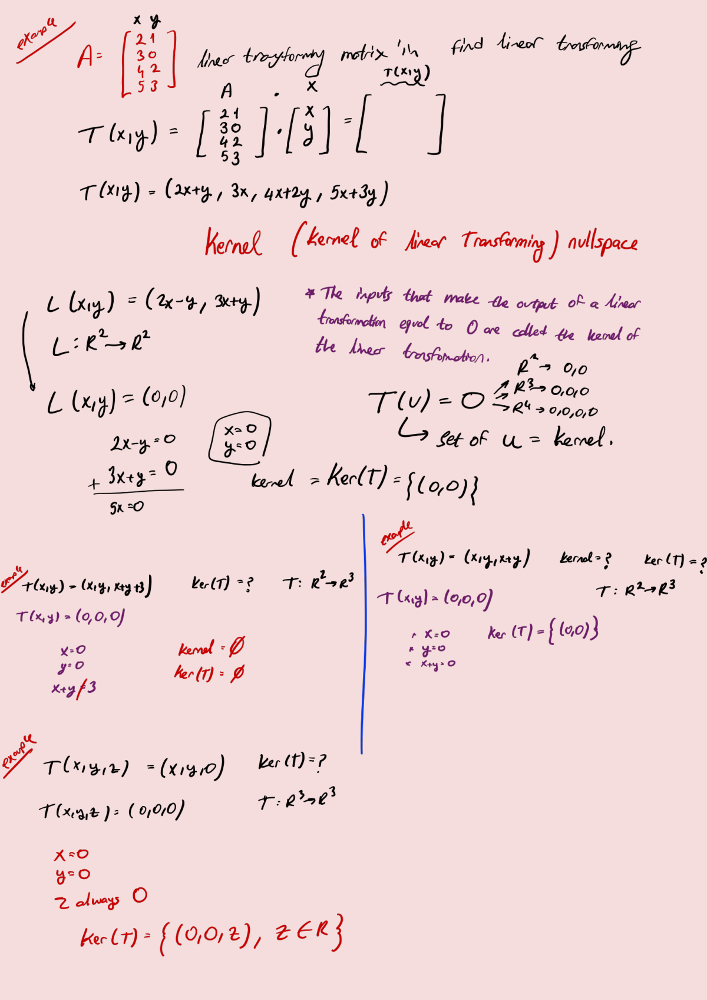
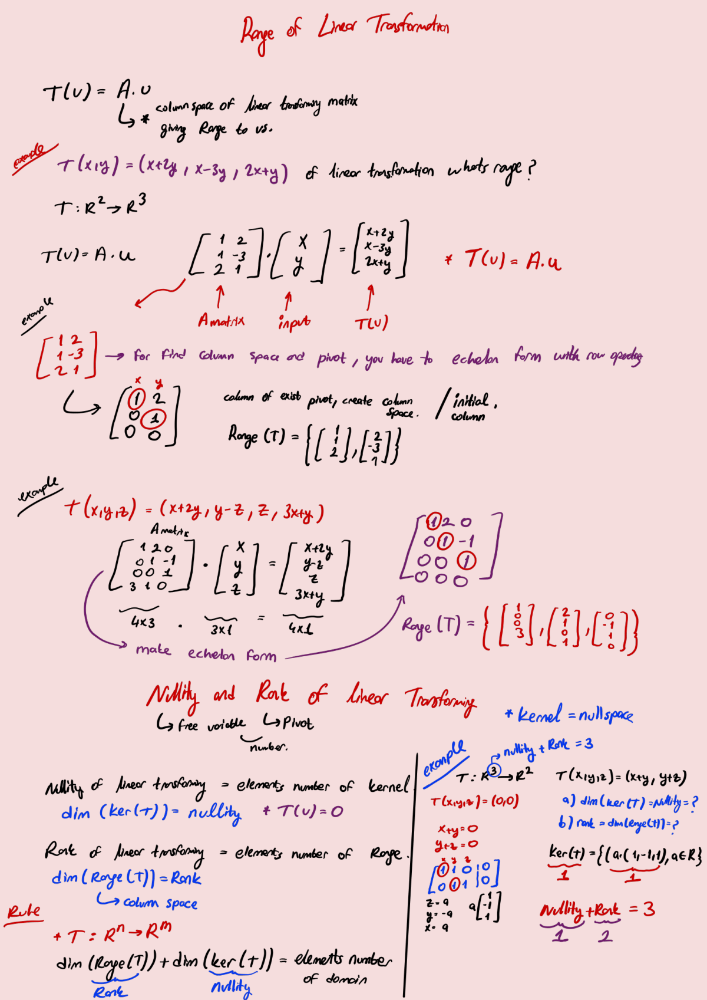

# linear transformations

handwritten notes, mathematical derivations and numerical verifications for linear transformation definitions, linearity conditions, standard transformation matrices, kernel (null space), range (column space), rank, nullity, and the rank-nullity theorem

[download full notes pdf](./linear-transformations.pdf) | [runnable script: src/linear_transformations.py](./src/linear_transformations.py)

---

## linear transformation definition and linearity conditions

mapping vectors between vector spaces $T: V \to W$ (domain, codomain, and range), and verifying the two fundamental linearity axioms: additivity and homogeneity (scalar multiplication)

$$
T(u + v) = T(u) + T(v) \quad \text{and} \quad T(c \cdot u) = c \cdot T(u) \quad \forall\, u, v \in V,\; c \in \mathbb{R}
$$


---

## linearity tests and standard transformation matrices

testing linear vs. nonlinear mappings and representing any linear transformation $T: \mathbb{R}^n \to \mathbb{R}^m$ as matrix-vector multiplication $T(u) = A u$, where $A \in \mathbb{R}^{m \times n}$

$$
T(u) = A u, \qquad A \in \mathbb{R}^{m \times n}, \; u \in \mathbb{R}^n, \; T(u) \in \mathbb{R}^m
$$



### computational verification

```python
u2 = np.array([2.0, -1.0])
v2 = np.array([-3.0, 4.0])
u3 = np.array([1.0, -2.0, 3.0])
v3 = np.array([2.0, 5.0, -1.0])

T1 = lambda p: np.array([p[0] + p[1], 2 * p[0] - p[1], p[1]])
T2 = lambda p: np.array([p[0] * p[1], p[0] - p[1]])
T3 = lambda p: np.array([p[0] + p[1] + 2 * p[2], p[0] ** 2 + p[1] ** 2])
T4 = lambda p: np.array([3 * p[0], 2 * p[1], p[0] + p[1] + p[2]])

print("T1(x,y) = (x+y, 2x-y, y) linear:", check_linearity(T1, u2, v2)[0])
print("T2(x,y) = (x*y, x-y) linear:", check_linearity(T2, u2, v2)[0])
print("T3(x,y,z) = (x+y+2z, x^2+y^2) linear:", check_linearity(T3, u3, v3)[0])
print("T4(x,y,z) = (3x, 2y, x+y+z) linear:", check_linearity(T4, u3, v3)[0])

A_3x2 = np.array([[2.0, 1.0],
                  [0.0, 1.0],
                  [1.0, -3.0]])
T_direct = lambda p: np.array([2 * p[0] + p[1], p[1], p[0] - 3 * p[1]])
print("T(u) == A @ u holds:", np.allclose(T_direct(u2), A_3x2 @ u2))
print("A @ [2, -1]:", A_3x2 @ u2)
```

```text
T1(x,y) = (x+y, 2x-y, y) linear: True
T2(x,y) = (x*y, x-y) linear: False
T3(x,y,z) = (x+y+2z, x^2+y^2) linear: False
T4(x,y,z) = (3x, 2y, x+y+z) linear: True
T(u) == A @ u holds: True
A @ [2, -1]: [ 3. -1.  5.]
```

---

## kernel (null space) of a linear transformation

recovering a transformation formula from its matrix $A$, and computing the kernel $\ker(T)$: the set of all domain vectors mapped to the zero vector in the codomain

$$
\ker(T) = \{ u \in V \mid T(u) = 0_W \}
$$



### computational verification

```python
L = np.array([[2.0, -1.0],
              [3.0, 1.0]])
ker_L = null_space(L)
print("L(x,y) = (2x-y, 3x+y) nullity:", ker_L.shape[1])

P_xy = np.array([[1.0, 0.0, 0.0],
                 [0.0, 1.0, 0.0],
                 [0.0, 0.0, 0.0]])
ker_P = null_space(P_xy)
print("T(x,y,z) = (x, y, 0) nullity:", ker_P.shape[1])
print("kernel basis vector (z-axis):", np.round(ker_P.ravel(), 3))
```

```text
L(x,y) = (2x-y, 3x+y) nullity: 0
T(x,y,z) = (x, y, 0) nullity: 1
kernel basis vector (z-axis): [0. 0. 1.]
```

---

## range (column space), rank, nullity and rank-nullity theorem

finding the range of $T(u) = A u$ via row echelon reduction and pivot columns of the original matrix $A$, and connecting rank and nullity to the domain dimension

$$
\text{range}(T) = \text{col}(A), \qquad \text{rank}(T) = \dim(\text{range}(T)), \qquad \text{nullity}(T) = \dim(\ker(T))
$$

$$
\text{rank}(T) + \text{nullity}(T) = \dim(V) = n
$$



### computational verification

```python
# T(x, y, z) = (x + y, y + z)
A_r3_r2 = np.array([[1.0, 1.0, 0.0],
                    [0.0, 1.0, 1.0]])
r3 = np.linalg.matrix_rank(A_r3_r2)
ker_r3_r2 = null_space(A_r3_r2)
n3 = ker_r3_r2.shape[1]
ker_scaled = ker_r3_r2.ravel() / ker_r3_r2.ravel()[0]

print(f"T(x,y,z) = (x+y, y+z) | rank: {r3}, nullity: {n3}, rank + nullity = {r3 + n3} (domain dim: {A_r3_r2.shape[1]})")
print("kernel basis (scaled):", np.round(ker_scaled, 3))
print("A @ ker == 0 holds:", np.allclose(A_r3_r2 @ ker_scaled, 0.0))
```

```text
T(x,y,z) = (x+y, y+z) | rank: 2, nullity: 1, rank + nullity = 3 (domain dim: 3)
kernel basis (scaled): [ 1. -1.  1.]
A @ ker == 0 holds: True
```

---

## real-world and robotics applications

where linear transformations, kernels, and ranges run directly inside robotics, computer vision, and autonomous flight:

- **3d rotations and camera projection**: rotating a point from camera frame to body frame via $v_b = R v_c$ is a length-preserving linear transformation with trivial kernel ($\ker(R) = \{0\}$). projecting 3d points onto a 2d image plane via a pinhole camera matrix $P \in \mathbb{R}^{3 \times 4}$ has a 1d kernel — the camera optical center — which is why depth is lost along each viewing ray.
- **robot manipulator jacobians**: the differential kinematics map $\dot{x} = J(q)\dot{q}$ is a linear transformation from joint velocities to end-effector velocities. the **range** of $J(q)$ gives the achievable end-effector motion directions, while the **kernel** $\ker(J)$ gives self-motion joint velocities that move the robot's links without moving the end-effector (used for obstacle avoidance in redundant arms).
- **linearized flight dynamics**: around a hover trim state, nonlinear quadrotor equations are approximated by the linear state-space map $\dot{x} = A x + B u$, where the column space of the controllability matrix determines which flight states are reachable.
