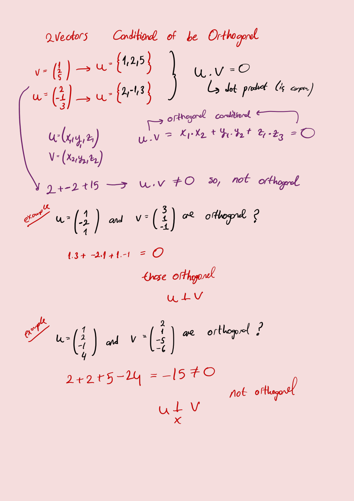
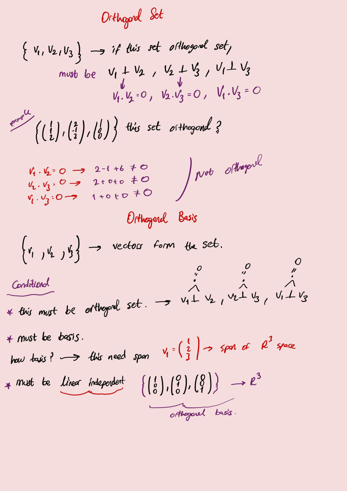
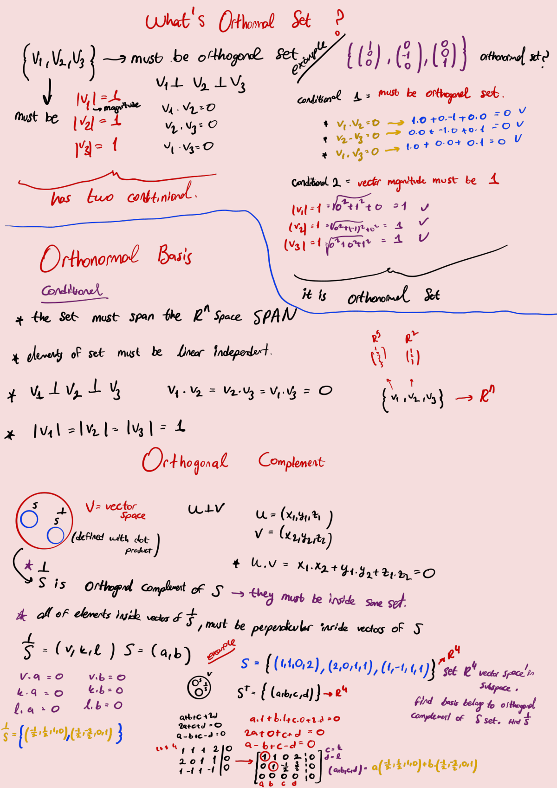
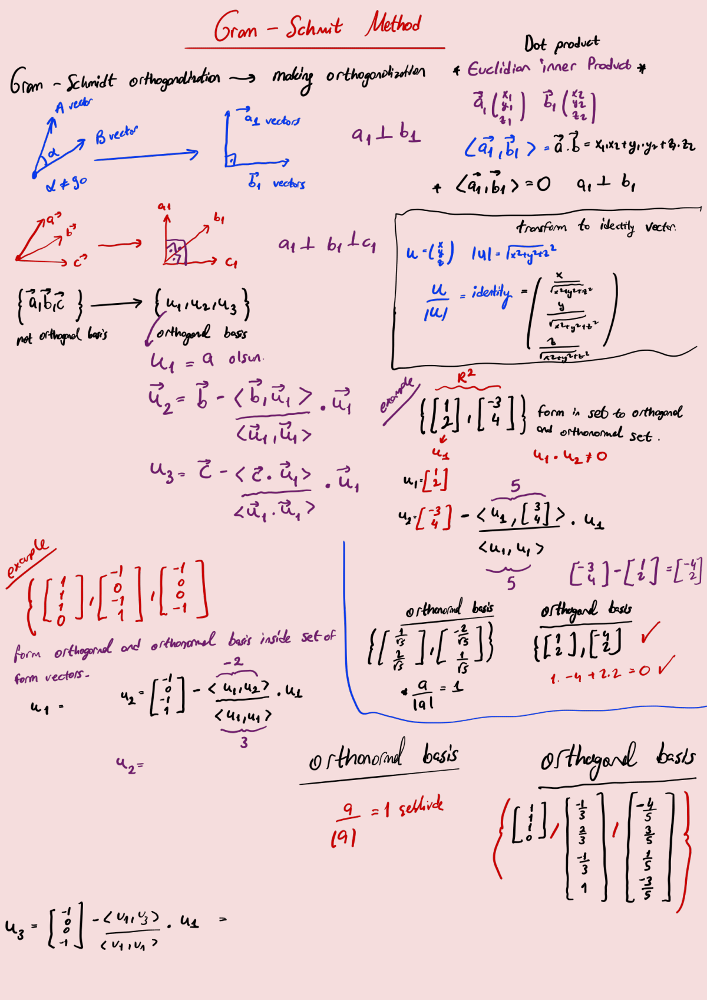
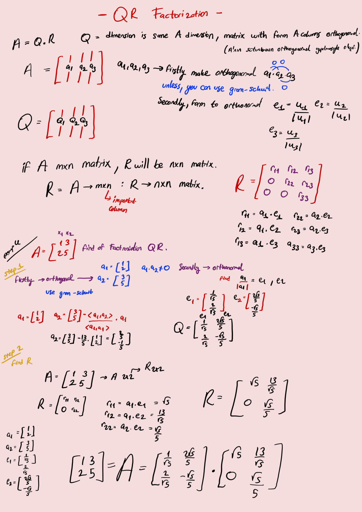
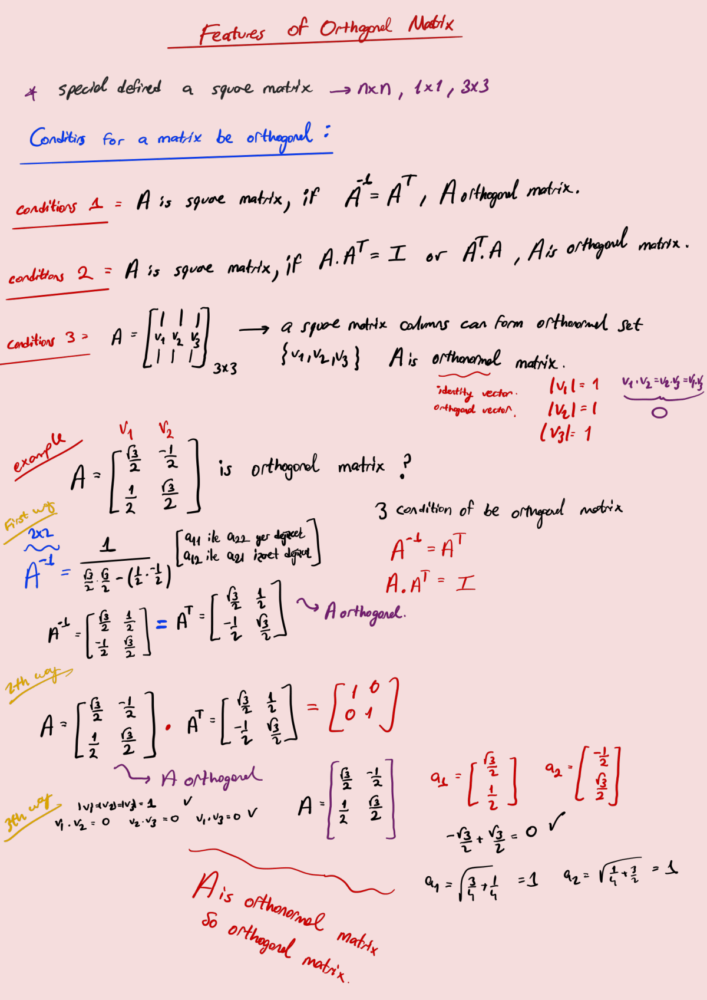
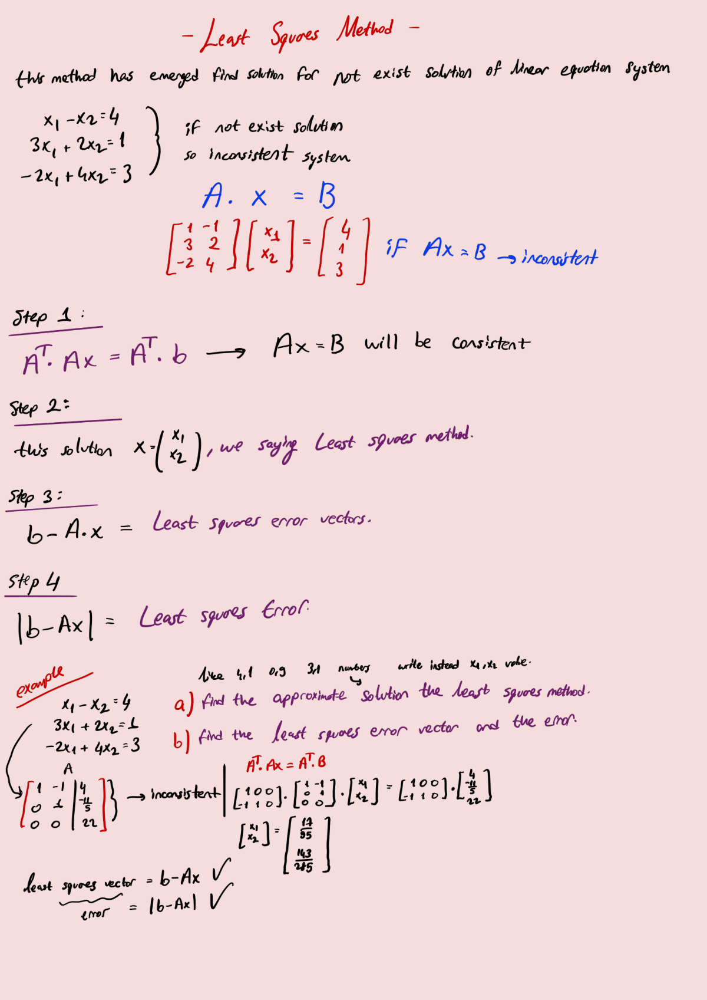
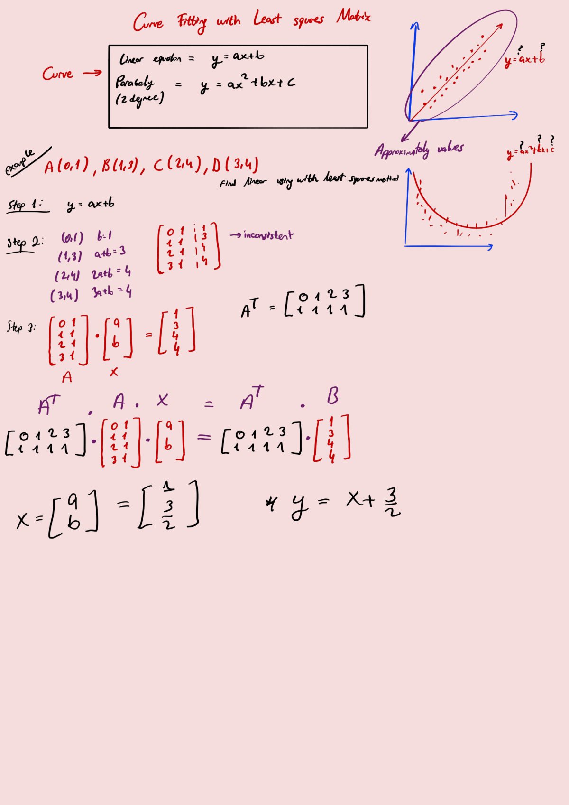

# orthogonality, gram-schmidt, qr factorization and least squares

handwritten notes, mathematical derivations and numerical verifications for orthogonal vectors, orthogonal and orthonormal bases, orthogonal complements, the gram-schmidt process, qr factorization, orthogonal matrices, and least squares curve fitting

[download full notes pdf](./orthogonality-and-least-squares.pdf) | [runnable script: src/orthogonality_and_least_squares.py](./src/orthogonality_and_least_squares.py)

---

## orthogonal vectors, sets and orthogonal bases

orthogonality condition via the dot product, pairwise orthogonality for vector sets, and requirements for a spanning, linearly independent orthogonal basis

$$
u \perp v \iff u \cdot v = \sum_{i=1}^n u_i v_i = 0
$$




### computational verification

```python
def is_orthogonal(u, v):
    return np.isclose(np.dot(u, v), 0.0)

u1 = np.array([1.0, -2.0, 1.0])
v1 = np.array([3.0, 1.0, -1.0])
print("u1 . v1 =", np.dot(u1, v1), "| orthogonal:", is_orthogonal(u1, v1))

u2 = np.array([1.0, 2.0, -1.0, 4.0])
v2 = np.array([2.0, 1.0, -5.0, -6.0])
print("u2 . v2 =", np.dot(u2, v2), "| orthogonal:", is_orthogonal(u2, v2))
```

```text
u1 . v1 = 0.0 | orthogonal: True
u2 . v2 = -15.0 | orthogonal: False
```

---

## orthonormal sets, orthonormal bases and orthogonal complement

unit-length orthogonal sets ($\|v_i\| = 1$ and $v_i \cdot v_j = 0$ for $i \ne j$), orthonormal bases, and finding the orthogonal complement $S^\perp$ of a subspace $S \subseteq \mathbb{R}^n$

$$
S^\perp = \{ w \in \mathbb{R}^n \mid w \cdot s = 0 \;\; \forall\, s \in S \}
$$



### computational verification

```python
def is_orthonormal_set(vectors):
    n = len(vectors)
    for i in range(n):
        if not np.isclose(np.linalg.norm(vectors[i]), 1.0):
            return False
        for j in range(i + 1, n):
            if not np.isclose(np.dot(vectors[i], vectors[j]), 0.0):
                return False
    return True

e1 = np.array([1.0, 0.0, 0.0])
e2 = np.array([0.0, -1.0, 0.0])
e3 = np.array([0.0, 0.0, 1.0])
print("standard signed set is orthonormal:", is_orthonormal_set([e1, e2, e3]))

S = np.array([
    [1.0, 1.0, 0.0, 2.0],
    [2.0, 0.0, 1.0, 1.0],
    [1.0, -1.0, 1.0, 1.0]
])
S_perp = null_space(S)
print("S_perp dimension:", S_perp.shape[1])
print("S @ S_perp == 0:", np.allclose(S @ S_perp, 0.0))
```

```text
standard signed set is orthonormal: True
S_perp dimension: 1
S @ S_perp == 0: True
```

---

## gram-schmidt orthogonalization

converting any linearly independent basis $\{a_1, a_2, \dots, a_k\}$ into an orthogonal basis $\{u_1, u_2, \dots, u_k\}$ by subtracting vector projections, then normalizing each vector to get an orthonormal basis

$$
u_k = a_k - \sum_{j=1}^{k-1} \frac{\langle a_k, u_j \rangle}{\langle u_j, u_j \rangle} u_j, \qquad e_k = \frac{u_k}{\|u_k\|}
$$



### computational verification

```python
def gram_schmidt(vectors):
    orthogonal = []
    for v in vectors:
        w = v.copy()
        for u in orthogonal:
            proj = (np.dot(v, u) / np.dot(u, u)) * u
            w = w - proj
        orthogonal.append(w)

    orthonormal = []
    for u in orthogonal:
        orthonormal.append(u / np.linalg.norm(u))
    return orthogonal, orthonormal

a1 = np.array([1.0, 2.0])
a2 = np.array([-3.0, 4.0])
orth_2d, onorm_2d = gram_schmidt([a1, a2])
print("gram-schmidt 2d orthogonal basis:", [np.round(vec, 3).tolist() for vec in orth_2d])
print("gram-schmidt 2d orthonormal check:", is_orthonormal_set(onorm_2d))
```

```text
gram-schmidt 2d orthogonal basis: [[1.0, 2.0], [-4.0, 2.0]]
gram-schmidt 2d orthonormal check: True
```

---

## qr factorization and orthogonal matrices

decomposing $A \in \mathbb{R}^{m \times n}$ into an orthonormal-column matrix $Q$ and an upper triangular matrix $R$ via gram-schmidt, and verifying the three equivalent properties of square orthogonal matrices

$$
A = Q R, \qquad R = Q^T A
$$

$$
A^{-1} = A^T \iff A A^T = A^T A = I
$$




### computational verification

```python
A_qr = np.array([
    [1.0, 3.0],
    [2.0, 5.0]
])

cols = [A_qr[:, 0], A_qr[:, 1]]
_, q_cols = gram_schmidt(cols)
Q = np.column_stack(q_cols)
R = Q.T @ A_qr

print("Q:\n", np.round(Q, 4))
print("R:\n", np.round(R, 4))
print("Q @ R == A:", np.allclose(Q @ R, A_qr))
print("Q.T @ Q == I:", np.allclose(Q.T @ Q, np.eye(2)))

A_orth = np.array([
    [np.sqrt(3.0) / 2.0, -0.5],
    [0.5, np.sqrt(3.0) / 2.0]
])
print("A_orth inverse == transpose:", np.allclose(np.linalg.inv(A_orth), A_orth.T))
print("A_orth @ A_orth.T == I:", np.allclose(A_orth @ A_orth.T, np.eye(2)))
```

```text
Q:
 [[ 0.4472  0.8944]
 [ 0.8944 -0.4472]]
R:
 [[ 2.2361  5.8138]
 [-0.      0.4472]]
Q @ R == A: True
Q.T @ Q == I: True
A_orth inverse == transpose: True
A_orth @ A_orth.T == I: True
```

---

## least squares method and curve fitting

solving inconsistent overdetermined systems $A x = b$ by projecting $b$ onto the column space of $A$ through the normal equations $A^T A \hat{x} = A^T b$, computing the residual error $\|b - A\hat{x}\|$, and fitting a line $y = a x + b$ to noisy data points

$$
A^T A \hat{x} = A^T b, \qquad e = b - A \hat{x}, \qquad \text{error} = \|b - A \hat{x}\|
$$




### computational verification

```python
# overdetermined system (page 7)
A_ls = np.array([
    [1.0, -1.0],
    [3.0, 2.0],
    [-2.0, 4.0]
])
b_ls = np.array([4.0, 1.0, 3.0])

x_hat = np.linalg.solve(A_ls.T @ A_ls, A_ls.T @ b_ls)
error_vec = b_ls - A_ls @ x_hat
error_norm = np.linalg.norm(error_vec)

print("least squares solution x_hat:", np.round(x_hat, 4))
print("residual vector (b - A x):", np.round(error_vec, 4))
print("least squares error ||b - A x||:", round(error_norm, 4))

# linear curve fitting (page 8): points (0,1), (1,3), (2,4), (3,4)
A_fit = np.array([
    [0.0, 1.0],
    [1.0, 1.0],
    [2.0, 1.0],
    [3.0, 1.0]
])
b_fit = np.array([1.0, 3.0, 4.0, 4.0])

params = np.linalg.solve(A_fit.T @ A_fit, A_fit.T @ b_fit)
a_slope, b_intercept = params
print(f"best-fit line: y = {a_slope:.2f}x + {b_intercept:.2f}")
```

```text
least squares solution x_hat: [0.1789 0.5018]
residual vector (b - A x): [ 4.3228 -0.5404  1.3509]
least squares error ||b - A x||: 4.5611
best-fit line: y = 1.00x + 1.50
```

---

## real-world and robotics applications

where orthogonality, qr factorization, and least squares run inside real perception, state estimation, and autonomous flight pipelines:

- **3d rotation matrices ($SO(3)$) and re-orthogonalization**: every 3d attitude matrix $R \in SO(3)$ is an orthogonal matrix ($R^{-1} = R^T$, $\det(R) = +1$). during high-rate imu integration on a drone, floating-point drift slowly breaks orthogonality, so flight controllers periodically re-orthogonalize $R$ using gram-schmidt or svd.
- **qr factorization in slam and visual-inertial odometry**: factor graph solvers (like isam2 / gtsam) use incremental qr factorization to solve large sparse nonlinear least squares problems without forming the ill-conditioned normal matrix $A^T A$ directly.
- **least squares in sensor calibration and lidar plane fitting**: fitting ground planes from noisy 3d lidar point clouds, calibrating magnetometer/accelerometer bias and scale factors, and triangulating 3d landmarks from multiple camera views all reduce directly to solving overdetermined least squares systems.
