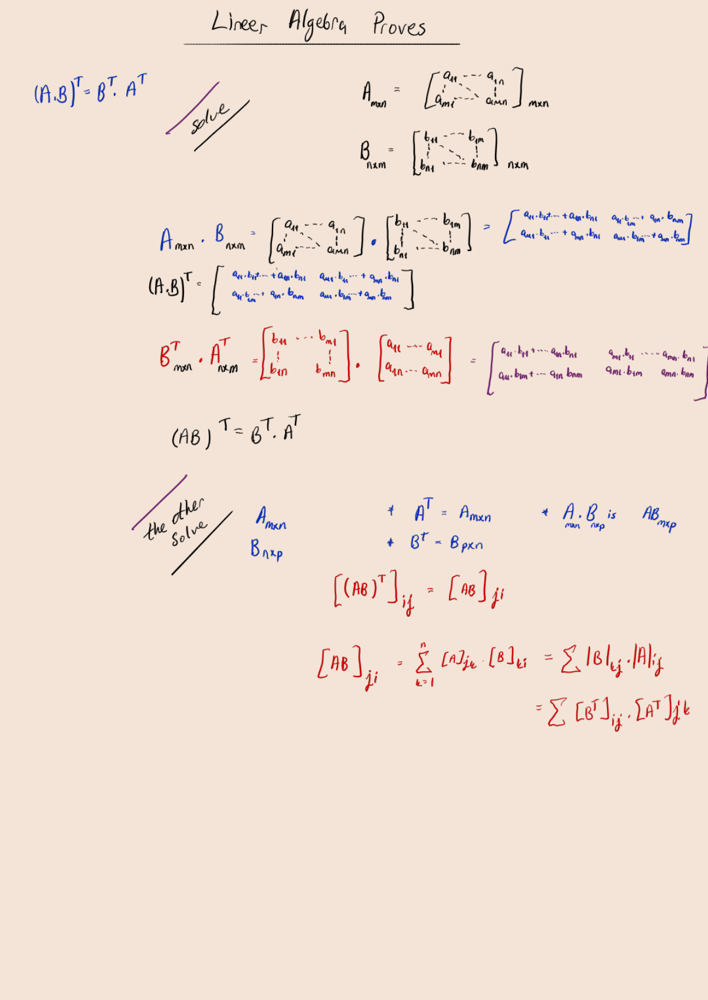
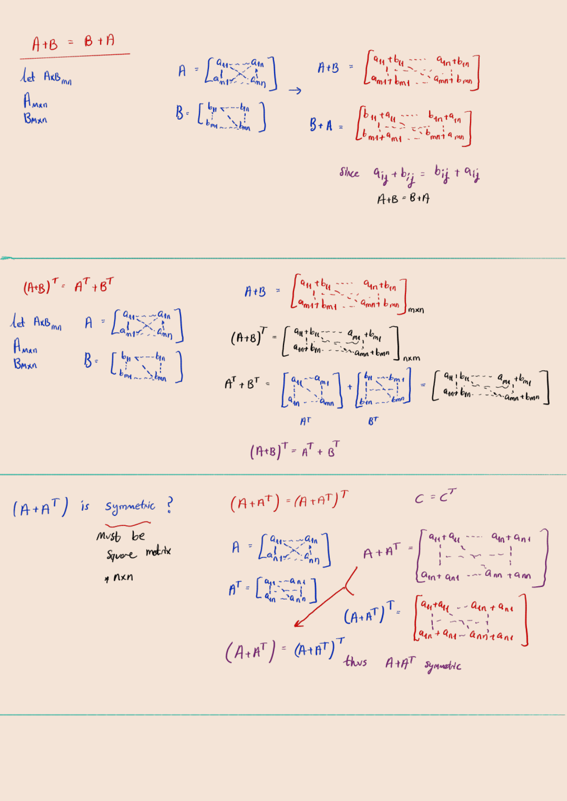
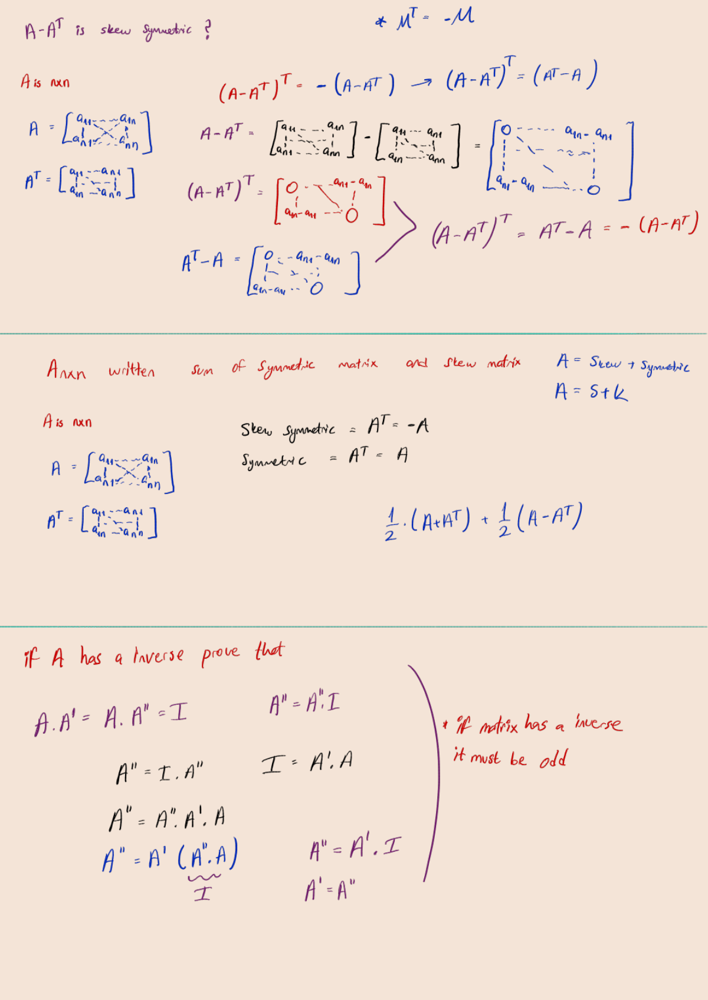
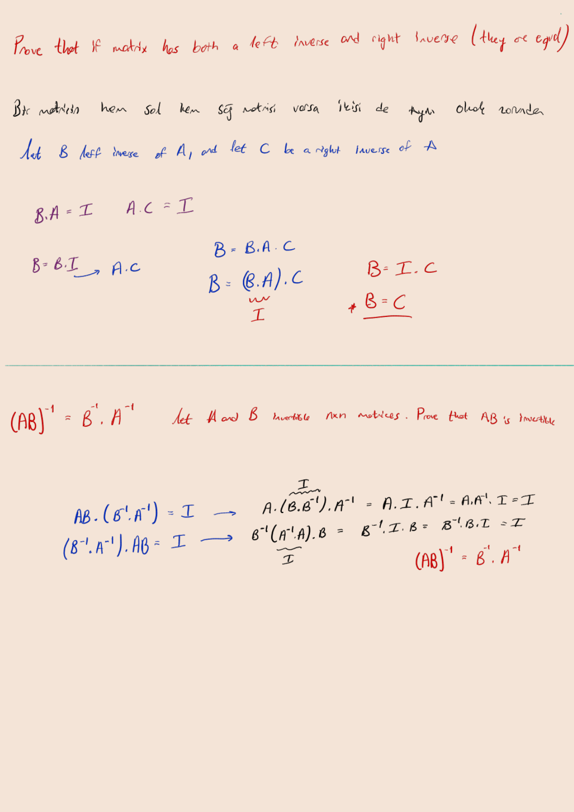
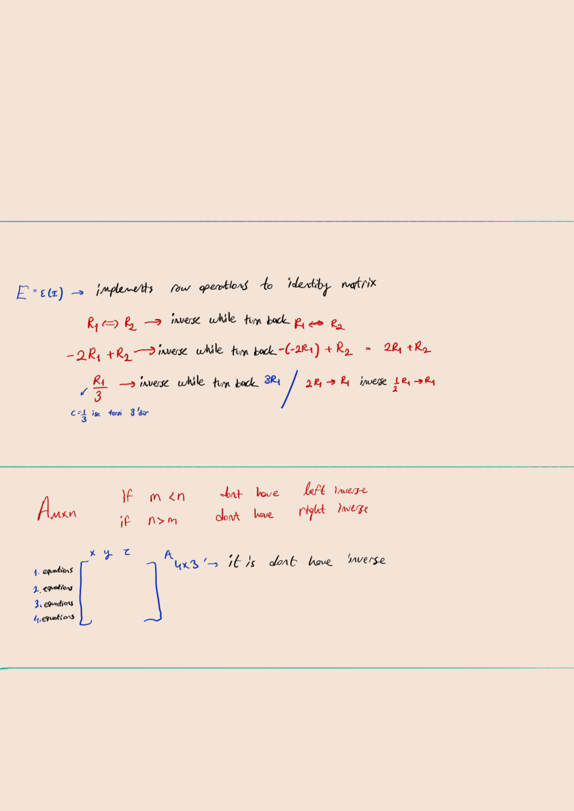
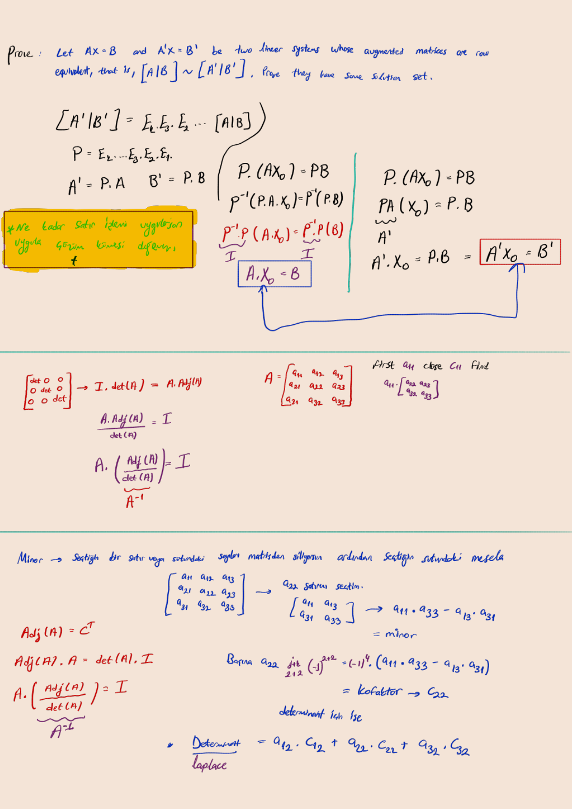
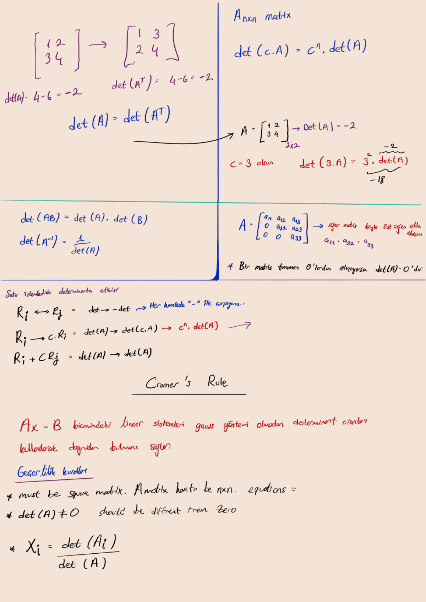
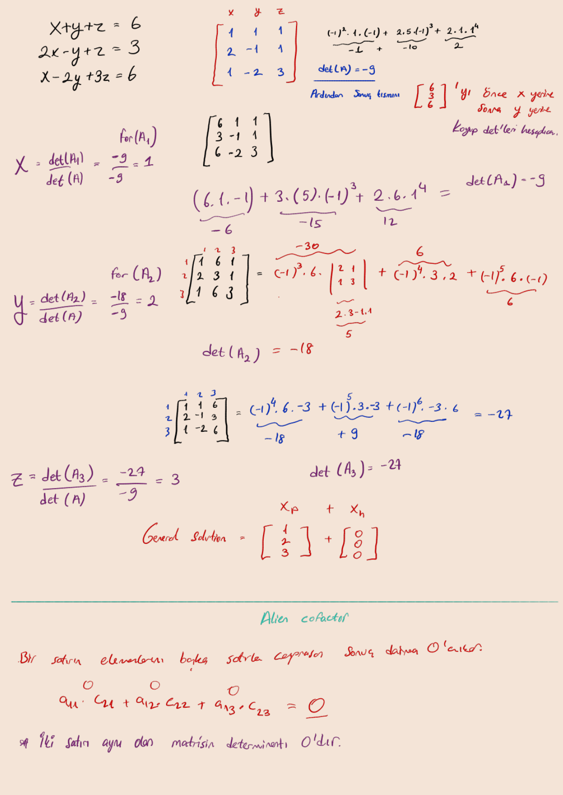
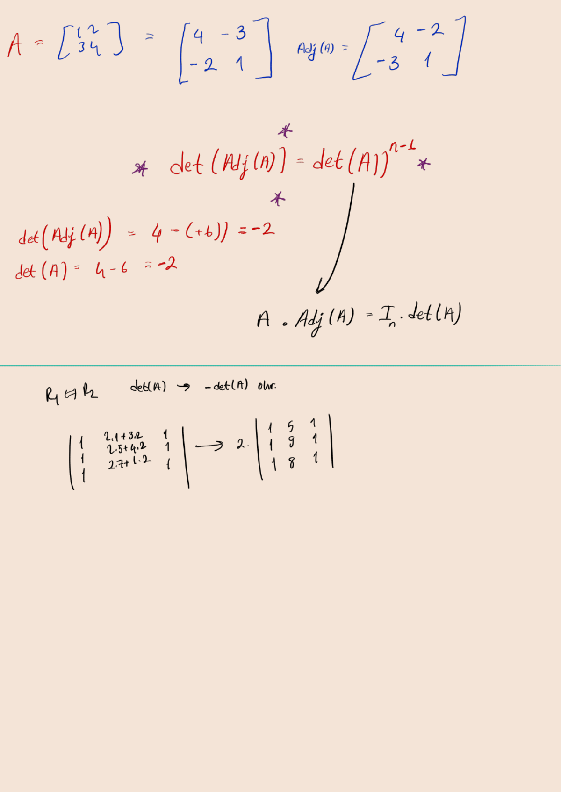

# linear algebra

handwritten derivations and proofs for matrix algebra fundamentals

[download full notes pdf](./linear-algebra-proofs.pdf)

---

## transpose and matrix symmetry

handwritten derivations for matrix transpose rules, addition commutativity and symmetry proofs

---

## skew symmetry and inverse uniqueness

proofs for skew symmetric decomposition, matrix inverse uniqueness and two sided inverse equality

---

## row operations and rectangular matrices

elementary row operations, row equivalence of linear systems and inverse conditions on rectangular matrices

---

## determinants and cramer rule

determinant properties, derivation of cramer rule and step by step solution of 3x3 linear systems

---

## adjugate matrix properties

properties of the adjugate matrix and determinant calculations

